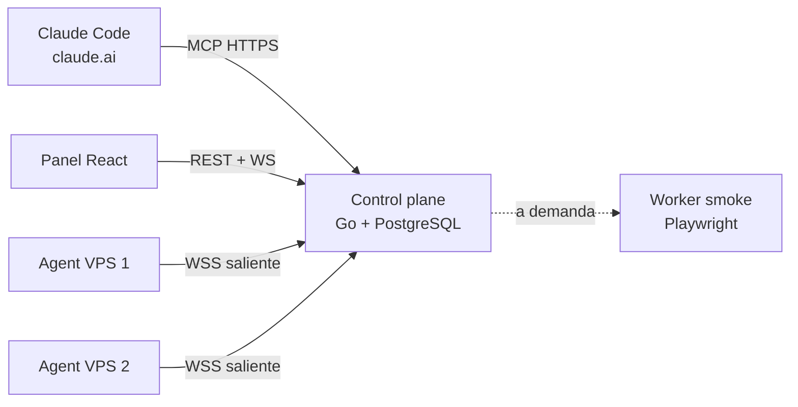
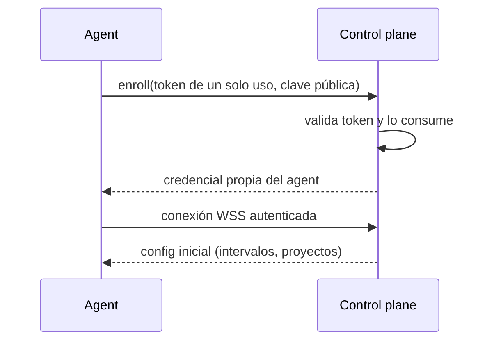
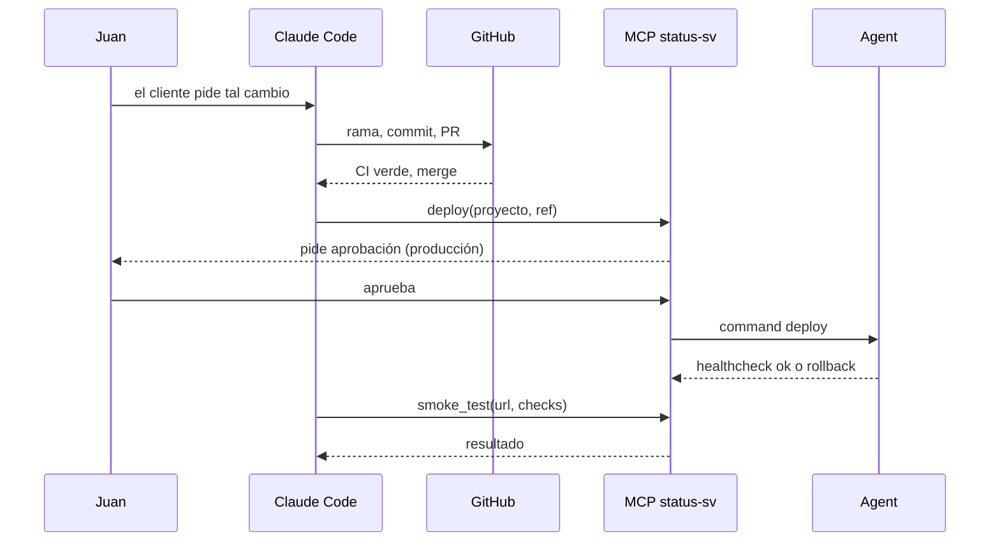

# status-sv: Documento de diseño

Última actualización: 2026-10-08

## Visión y alcance

status-sv es una plataforma propia para observar y operar servidores VPS: un panel con métricas y estado en vivo, y un MCP remoto para que Claude Code (y después claude.ai) despliegue, reconstruya y verifique proyectos sin recibir acceso de shell.

**Objetivos**

- Ver en un solo panel CPU, RAM, disco, red, contenedores y servicios de todos los servidores.
- Automatizar el ciclo repetitivo: cambio pedido → PR → merge → deploy → healthcheck → verificación web.
- Consumir muy poco: agent por debajo de 30 MB de RAM y 1% de CPU en reposo.
- Ser seguro para darle a un LLM acceso a producción: herramientas tipadas, scopes, aprobaciones y auditoría.

**Dentro del MVP (Fases 1 a 3)**

- Agent en Go con métricas, Docker y systemd.
- Control plane con API, WebSocket y PostgreSQL.
- Panel React multi-servidor.
- Motor de deploy con healthcheck y rollback.
- MCP remoto por HTTPS con tokens y scopes, conectado a Claude Code.

**Fuera del MVP**

- Multiusuario u organizaciones, facturación y roles finos.
- Agents para Windows o macOS.
- Orquestación tipo Kubernetes y autoscaling.
- Edición de archivos de configuración desde el panel, incluidas las plantillas de la unidad y del sitio, que el panel solo muestra ([ADR-023](adr/ADR-023-plantillas-sitio-y-certificado.md)).
- OAuth para claude.ai (Fase 4).

## Principios de diseño

Seis reglas guían cada decisión: si una funcionalidad las rompe, se rediseña.

1. **El LLM llama operaciones, no comandos.** El MCP expone herramientas tipadas (`deploy`, `rollback`, `get_logs`) y nunca `run_shell`. La lógica riesgosa vive en código determinístico.
2. **El agent solo hace conexiones salientes.** Ningún VPS abre puertos nuevos ni deja SSH expuesto para que el panel lo controle.
3. **Solo se despliega lo declarado.** Un proyecto debe tener su `project.yaml`; lo demás se observa en modo solo lectura.
4. **Los secretos nunca viajan al LLM ni al panel.** Se resuelven en el servidor donde corre el agent.
5. **Toda acción deja rastro.** Quién (persona o LLM), qué, cuándo y con qué resultado, en un log de auditoría inmutable.
6. **Liviano por diseño.** Se mide desde el primer sprint contra metas concretas (ver Metas de rendimiento), no se optimiza al final.

## Arquitectura

Son cuatro piezas: un agent por servidor, un control plane que concentra todo, un MCP como capa fina encima de la API, y un panel web. Los agents se conectan hacia afuera y mantienen un canal abierto.



Los agents inician la conexión, así que el control plane nunca necesita alcanzar a los VPS. Por el mismo canal viajan las métricas hacia arriba y las órdenes hacia abajo.

| Pieza | Responsabilidad | Corre en |
| --- | --- | --- |
| Agent | Recolecta métricas de `/proc` y del stream de eventos de Docker. Ejecuta deploys, restarts y rollbacks de proyectos declarados. | Cada VPS, como servicio systemd |
| Control plane | API REST, WebSocket para el panel, MCP, auth, auditoría, aprobaciones y agregación de métricas. | Un VPS central, un binario |
| MCP | Herramientas tipadas sobre la API. No tiene lógica propia. | Dentro del control plane |
| Panel | Vistas de servidores, proyectos, deploys y auditoría. Se compila a estáticos embebidos en el binario. | Servido por el control plane |
| Worker de smoke tests | Playwright headless que se levanta a demanda para verificar URLs. | Contenedor aparte |

**Adaptadores de runtime del agent**

- **Docker:** contenedores, estado, healthchecks, logs y consumo por contenedor.
- **systemd:** servicios como gunicorn y nginx, con logs vía journald.
- **Descubrimiento de procesos:** lo que corre fuera de Docker y systemd aparece como "no gestionado", solo lectura.

## Stack tecnológico

Go en agent y servidor, PostgreSQL como base, y React con Vite para el panel. La prioridad es bajo consumo y velocidad, con un front de aspecto profesional.

| Capa | Elección | Por qué |
| --- | --- | --- |
| Agent | Go | Binario estático único, 15 a 30 MB de RAM, casi 0% de CPU en reposo, sin dependencias en el VPS. |
| Control plane y MCP | Go | Mismo lenguaje que el agent: tipos compartidos y un solo binario. Maneja miles de conexiones con poca memoria. |
| Base de datos | PostgreSQL | Concurrencia real, tipos JSONB, particionado por tiempo para métricas y migraciones maduras. |
| Acceso a datos | `pgx` + `sqlc` | Consultas SQL tipadas y generadas, sin ORM pesado. |
| Migraciones | `goose` ([ADR-004](adr/ADR-004-modulo-go-unico-y-goose.md)) | Versionadas dentro del repo, embebidas en el binario y aplicadas con un subcomando explícito. |
| Front | React + Vite + TypeScript | Se compila a estáticos y en producción no hay Node corriendo. |
| UI | Tailwind + shadcn/ui | Aspecto profesional sin diseñar todo desde cero. |
| Gráficos | uPlot | La librería de series de tiempo más liviana y rápida para métricas en vivo. |
| Estado del front | TanStack Query + WebSocket | Datos en vivo sin polling. |
| Contratos | JSON versionado en `proto/` ([ADR-003](adr/ADR-003-contratos-json-versionado.md)) | Un solo origen para los mensajes agent ↔ servidor, legible al depurar. |
| Smoke tests | Playwright | En un worker aparte, porque el navegador es pesado. |
| Despliegue propio | Docker Compose, detrás de Caddy o de un nginx existente | Caddy da HTTPS automático en un servidor dedicado; corre detrás del nginx de un servidor propio compartido con otros productos ([ADR-018](adr/ADR-018-control-plane-en-servidor-propio-compartido.md)), adonde se mudó desde el servidor de un cliente el 2026-10-02. El VPS dedicado queda como destino ([ADR-014](adr/ADR-014-control-plane-en-vps-propio.md)). |

**Sobre PostgreSQL**

La base corre como un contenedor más en el VPS central. Para métricas se usan tablas particionadas por día (o TimescaleDB si el volumen lo pide). No hace falta TimescaleDB en el MVP: el particionado nativo y los agregados propios alcanzan para decenas de servidores.

**Sobre Go**

Tu stack fuerte hoy es Python, así que las primeras semanas van a ser de curva. Por eso el Sprint 0 incluye un agent mínimo de punta a punta, para aprender el lenguaje sobre algo real y acotado.

## Modelo de datos

Quince entidades cubren el MVP. Las métricas crudas y agregadas viven particionadas por tiempo para que borrar datos viejos sea soltar una partición, no un DELETE masivo, y sus discos e interfaces van en tablas aparte ([ADR-008](adr/ADR-008-tablas-de-metricas.md)).

| Tabla | Contenido | Notas |
| --- | --- | --- |
| `servers` | Nombre, host, estado, versión del agent, último contacto, etiquetas. | Un registro por VPS enrolado. |
| `agent_credentials` | Hash de credencial por agent, fecha de emisión y revocación. | Se guarda solo el hash. |
| `enrollment_tokens` | Token de un solo uso, expiración y servidor resultante. | Vence en 15 minutos. |
| `projects` | Servidor, nombre, tipo de runtime (docker o systemd), URL de healthcheck, entorno, y el último resultado del healthcheck. | Nace del `project.yaml` que el agent lee en su servidor; el control plane no lo puede crear ni cambiar ([ADR-012](adr/ADR-012-proyectos-declarados-en-el-servidor.md)). |
| `project_proposals` | Servidor, nombre, la declaración propuesta y su hash, estado (pendiente, entregada, aceptada, retirada o vencida), quién la propuso y cuándo. | La propuesta de un proyecto nuevo, armada en el panel o por MCP. No declara nada: lo declara una persona al aceptarla en el servidor ([ADR-022](adr/ADR-022-alta-de-proyectos-propuesta-y-aceptacion.md)). Entra en el Sprint 6. |
| `deploys` | Proyecto, tipo (deploy o rollback), commit pedido y desplegado, commit anterior, estado, quién lo pidió, tiempos y la foto de sus pasos con los últimos renglones de cada uno. | Estados: pending, running, succeeded, failed, rolled_back (approved llega con las aprobaciones de la Fase 3). Un solo deploy activo por proyecto ([ADR-015](adr/ADR-015-motor-de-deploy-docker.md), [ADR-017](adr/ADR-017-deploy-desde-el-panel-y-auditoria.md)). |
| `runtime_units` | Último estado conocido de cada contenedor, servicio y proceso no gestionado de un servidor: nombre, estado, consumo y cuándo se lo vio. `runtime_sources` guarda si cada fuente (Docker, systemd, procesos) se pudo leer, y `servers.runtime_taken_at` la marca de la última foto. | Se reemplaza con cada `runtime_state`; no guarda historia. |
| `metrics_raw` | Servidor, instante, CPU (uso, iowait, steal), RAM, swap y carga. Los discos van en `metrics_raw_disks` y las interfaces en `metrics_raw_networks`, una fila por cada uno y por muestra. | Partición diaria, retención 48 horas. |
| `metrics_1m` | Lo mismo agregado por minuto: promedio y máximo de CPU, iowait, memoria y swap, el peor momento de cada disco y tasas de red. También con `metrics_1m_disks` y `metrics_1m_networks`. | Partición mensual, retención 30 días. |
| `metrics_1h` | Agregado por hora desde `metrics_1m`: mínimo y promedio de los promedios por minuto, y máximo de los máximos. También con `metrics_1h_disks` y `metrics_1h_networks`. | Partición mensual, retención 1 año. |
| `audit_log` | Actor, tipo de actor (persona, LLM, agent o sistema), acción, objetivo, resultado, IP y un detalle corto. | Solo inserciones: un trigger rechaza UPDATE, DELETE y TRUNCATE. Entra en el Sprint 4 ([ADR-017](adr/ADR-017-deploy-desde-el-panel-y-auditoria.md)). |

**Tablas de acceso**

- `users`: cuenta del panel con hash de contraseña (argon2id) y secreto TOTP cifrado; los códigos de recuperación van en `user_recovery_codes`, como hash ([ADR-013](adr/ADR-013-segundo-factor-totp.md)).
- `sessions`: sesión del panel, guardada como hash del token que viaja en la cookie; vence a las 24 h sin uso o a los 7 días ([ADR-010](adr/ADR-010-usuarios-y-sesiones-del-panel.md)).
- `api_tokens`: token del MCP con hash, scopes por proyecto y entorno, y vencimiento.
- `approvals`: solicitud de aprobación humana con el deploy asociado, quién aprobó y cuándo.

**Reglas**

- Los IDs son UUID v7, que se ordenan por tiempo y son buenos índices.
- `audit_log` no admite UPDATE ni DELETE: se aplica con permisos del rol de la aplicación.
- La ingesta recalcula el agregado por minuto de los minutos que toca cada lote, en la misma transacción y siempre desde el crudo, así que las muestras que llegan tarde o repetidas no lo desarman ([ADR-009](adr/ADR-009-agregado-por-minuto-en-la-ingesta.md)). El agregado por hora (`metrics_1h`, Sprint 3) sigue el mismo camino a partir de `metrics_1m`. Un job interno crea las particiones por adelantado y borra las vencidas, cada hora, con funciones de la migración que escapan los nombres ([ADR-008](adr/ADR-008-tablas-de-metricas.md)). Todos los cortes son en UTC y no hay partición por defecto.
- Los estados de servidor (online, offline, degradado) se derivan del último contacto, no se escriben a mano.

## Protocolo agent ↔ control plane

El agent abre un WebSocket seguro (WSS) hacia el control plane y lo mantiene abierto. Los mensajes son binarios (Protobuf) o JSON compacto, definidos en `proto/`, y llevan versión para poder actualizar agents sin romper compatibilidad.

**Enrolamiento**



El token se genera desde el panel, se usa una vez y vence a los 15 minutos. Después el agent usa su propia credencial, revocable desde el panel. La meta es mTLS en la Fase 4.

**Mensajes**

| Dirección | Mensaje | Contenido | Frecuencia |
| --- | --- | --- | --- |
| Agent → servidor | `metrics` | Lote de muestras de CPU, RAM, disco, red y carga. | Cada 5 a 10 s |
| Agent → servidor | `runtime_state` | Foto completa de contenedores, servicios y procesos no gestionados, con su estado y consumo. | Al cambiar algo, y cada tanto con el consumo al día |
| Agent → servidor | `projects_state` | Proyectos declarados en el servidor, los archivos inválidos (sin su contenido) y el resultado del healthcheck. | Al cambiar algo, y cada 5 minutos |
| Agent → servidor | `deploy_event` | Foto completa de un deploy: pasos, commits, resultado y los últimos renglones enmascarados de cada paso ([ADR-015](adr/ADR-015-motor-de-deploy-docker.md)). | Al cambiar de paso, y al reconectar si quedó sin confirmar |
| Agent → servidor | `heartbeat` | Vivo y versión. | Cada 15 s |
| Servidor → agent | `command` | Operación predefinida con parámetros validados. | A demanda |
| Servidor → agent | `config_update` | Nuevos intervalos o proyectos declarados. | A demanda |
| Servidor → agent | `project_proposal` | La propuesta de un proyecto nuevo, que el agent guarda sin ejecutar nada hasta que una persona la acepta ([ADR-022](adr/ADR-022-alta-de-proyectos-propuesta-y-aceptacion.md)). | Al proponer, y al reconectar si falta |

**Comandos permitidos**

`deploy`, `rollback`, `restart`, `stop`, `start`, `get_logs`, `healthcheck`, `discover` y `bootstrap` (deploy desde cero). El agent rechaza cualquier comando fuera de esta lista y cualquier proyecto que no esté declarado.

**Confiabilidad**

- Cada comando lleva un ID y el agent responde con un acuse; los comandos son idempotentes.
- Si se corta la conexión, el agent reconecta con backoff exponencial y acumula métricas en un buffer en memoria de hasta 10 minutos.
- Las métricas viajan con un solo lote en vuelo: el siguiente sale cuando llega el acuse, que confirma hasta qué marca de tiempo se guardó. Si el acuse no llega en 30 s o se corta el canal, el lote se reenvía, así que el control plane guarda de forma idempotente. Ningún mensaje del agent pasa de 256 KiB: los lotes grandes salen partidos.
- Un deploy en curso sigue aunque se corte el canal; el agent reporta el resultado al reconectar.
- Un servidor sin heartbeat por más de 45 s pasa a offline.

## MCP: herramientas, auth y aprobaciones

El MCP es remoto, usa transporte Streamable HTTP y vive dentro del control plane. Cada herramienta es una operación acotada con parámetros validados; ninguna acepta comandos libres.

| Herramienta | Tipo | Qué hace | Aprobación en producción |
| --- | --- | --- | --- |
| `list_servers` | Lectura | Servidores con estado y último contacto. | No |
| `get_server_metrics` | Lectura | CPU, RAM, disco y red en un rango de tiempo. | No |
| `list_projects` | Lectura | Proyectos por servidor, runtime y entorno. | No |
| `get_project_status` | Lectura | Estado, versión desplegada y healthcheck. | No |
| `get_logs` | Lectura | Últimas N líneas, con secretos enmascarados. | No |
| `list_deploys` | Lectura | Historial de deploys de un proyecto. | No |
| `deploy` | Escritura | Despliega una referencia con healthcheck y rollback automático. | Sí |
| `rollback` | Escritura | Vuelve a la versión anterior conocida. | Sí |
| `restart` | Escritura | Reinicia un proyecto declarado. | Sí |
| `smoke_test` | Verificación | Abre la URL con Playwright y valida checks definidos. | No |

**Autenticación**

1. **Etapa 1:** tokens de API con scopes por proyecto y entorno (por ejemplo `deploy:staging` sin `deploy:production`), con vencimiento y revocación. Alcanza para Claude Code.
2. **Etapa 2:** OAuth 2.1 con registro dinámico de clientes, que es lo que necesita claude.ai para conectores remotos.

**Aprobaciones**

Las herramientas de escritura sobre entornos de producción devuelven `pending_approval` con un ID. Vos aprobás o rechazás desde el panel (o con un enlace firmado), y recién ahí el control plane envía el comando al agent. Los entornos de staging pueden configurarse sin aprobación.

**Flujo completo con Claude Code**



Claude Code hace el trabajo de git y PR con `git` y `gh` locales. El MCP se ocupa de lo que Claude Code no puede hacer solo: desplegar, ver el estado real del servidor y verificar la web.

## Deploy desde cero

Además de actualizar proyectos existentes, status-sv levanta un proyecto completo en un servidor a partir de su repositorio. Es una operación distinta del `deploy` común porque crea cosas nuevas (usuario, directorio, servicio, sitio, certificado), así que siempre pide aprobación humana, también en staging.

Se construyó en dos partes ([ADR-021](adr/ADR-021-primer-deploy-y-reparto-del-deploy-desde-cero.md)). El Sprint 5 trajo el primer deploy: clonar, compilar, levantar y verificar un proyecto ya declarado. El Sprint 6 trae el alta: **el control plane propone el proyecto y una persona lo acepta en el servidor**, que es donde se crea lo que necesita root y donde se cargan los secretos ([ADR-022](adr/ADR-022-alta-de-proyectos-propuesta-y-aceptacion.md), [ADR-023](adr/ADR-023-plantillas-sitio-y-certificado.md)).

| Herramienta | Qué hace |
| --- | --- |
| `register_project` | Propone el proyecto nuevo: repo, servidor, runtime, entorno, dominio, puerto, healthcheck, pasos declarados y los nombres de las variables requeridas. No declara nada. |
| `bootstrap_project` | Ejecuta el primer deploy de un proyecto ya declarado. |

Las dos llegan al MCP en el Sprint 8; en el Sprint 6 se usan desde el panel.

**El alta, paso a paso**

1. **Proponer:** desde el panel (o con `register_project`), con vista previa de la declaración, la unidad y el sitio que se van a generar. La propuesta viaja al agent del servidor, que la guarda sin ejecutar nada.
2. **Aceptar en el servidor:** una persona corre `sudo statussv-agent project accept <nombre>`, que muestra la declaración y todo lo que va a crear, y pide confirmarlo. Crea el usuario (systemd), el `workdir`, la deploy key, el archivo de secretos, la unidad desde su plantilla y el sitio de nginx con su certificado; escribe el `project.yaml`, suma el `workdir` al drop-in del deploy, reinicia el agent y corre `deploy-check`.
3. **Secretos:** el mismo comando pide el valor de cada variable requerida, sin mostrarlo. Los valores no salen del servidor; al control plane llegan solo los nombres que faltan.
4. **Cargar la llave en GitHub:** el comando muestra la llave pública y el comando `gh` para cargarla como deploy key de solo lectura.
5. **Primer deploy:** desde el panel, con el código TOTP. Clona, compila (con Docker, `compose build`; con systemd, los pasos de `deploy.build`), corre los pasos declarados, levanta, verifica el healthcheck y, si queda bien, habilita las unidades. Si algo falla, baja lo que levantó; el sitio queda, contestando 502.

**Límites de seguridad**

- El control plane no puede declarar un proyecto: solo proponerlo. Lo declara una persona con root, que ve exactamente lo que se escribe ([ADR-012](adr/ADR-012-proyectos-declarados-en-el-servidor.md)).
- En una propuesta no se eligen el `workdir`, el usuario del proyecto ni el archivo de secretos: son fijos por nombre.
- Las plantillas de systemd y del proxy reciben parámetros validados, nunca texto libre del LLM. Solo una persona las cambia: por PR en el repo, o como root en el servidor. El panel las muestra con vista previa ([ADR-023](adr/ADR-023-plantillas-sitio-y-certificado.md)).
- Los pasos declarados son solo los de la declaración que una persona aceptó.
- La deploy key de cada proyecto es de solo lectura y vive en el servidor; se revoca sacándola de GitHub y borrando el archivo.

## Seguridad

El riesgo central es que un LLM con acceso a producción puede ser engañado. El diseño asume que el LLM puede equivocarse o ser manipulado, y limita el daño posible en cada capa.

| Amenaza | Mitigación |
| --- | --- |
| Prompt injection (un issue, PR o web con texto malicioso que induce a desplegar o borrar) | Herramientas acotadas, sin `run_shell`, aprobación humana en producción y auditoría de cada acción. |
| Token del MCP filtrado | Scopes por proyecto y entorno, vencimiento corto, revocación inmediata y alerta ante uso desde una IP nueva. |
| Agent comprometido o falso | Enrolamiento con token de un solo uso, credencial propia revocable y mTLS en la Fase 4. |
| Control plane comprometido | El agent solo ejecuta comandos de la lista permitida sobre proyectos declarados; no hay ejecución arbitraria. |
| Acceso al socket de Docker (equivale a root) | El agent corre con usuario dedicado, sin exponer el socket por red y con operaciones predefinidas únicamente. |
| Fuga de secretos | Las variables de entorno se resuelven en el servidor; los logs pasan por un filtro que enmascara patrones de secretos. |
| Deploy de código no revisado | El deploy exige una referencia que haya pasado por PR con CI verde y branch protection. |
| Abuso o error repetido | Límites de frecuencia por token y por proyecto, con bloqueo de deploys simultáneos sobre el mismo proyecto. |

**Controles transversales**

- HTTPS obligatorio en todo, con Caddy y certificados automáticos.
- Contraseñas con argon2id y TOTP obligatorio para cuentas con permiso de aprobar.
- Auditoría inmutable con actor, tipo de actor (persona o LLM), acción, objetivo y resultado.
- Actualizaciones firmadas del agent (verificación de checksum y firma antes de reemplazar el binario).
- El control plane corre sin privilegios de root, en contenedor, con el sistema de archivos en solo lectura donde sea posible.

**Chequeos de seguridad del servidor (Fase 4)**

Intentos fallidos de SSH, puertos abiertos, actualizaciones pendientes, expiración de certificados, estado de backups y contenedores corriendo como root.

## Metas de rendimiento

Las metas se verifican desde el Sprint 1 con pruebas automáticas; si una se rompe, el pipeline falla.

| Métrica | Meta | Cómo se mide |
| --- | --- | --- |
| RAM del agent en reposo | Menos de 30 MB | El agent mide su propia memoria y la manda en el latido; la prueba de carga la verifica. |
| CPU del agent en reposo | Menos de 1% | Promedio de los latidos: 2 minutos en cada PR y 10 en el workflow nocturno. |
| RAM del control plane con 10 agents | Menos de 100 MB | Prueba de carga con agents simulados, que usan el cliente del agent de verdad. |
| Latencia métrica → pantalla | Menos de 2 s | Marca de tiempo en el agent contra el cuadro en que el panel la dibuja, en CI (`deploy/metas`). |
| Carga inicial del panel | Menos de 1 s en conexión normal | Largest Contentful Paint de Lighthouse (perfil de escritorio) sobre el login y la lista, en CI. |
| Tamaño del bundle del front | Menos de 300 KB comprimido | Análisis del build de Vite. |
| Tamaño del binario del agent | Menos de 15 MB | Verificación en el build. |
| Inicio de un deploy | Menos de 3 s desde la orden | Evento `deploy_event` de arranque. |

**Cómo se logra**

- El agent lee `/proc` directamente y escucha el stream de eventos de Docker en vez de consultar cada tanto.
- Las métricas se envían en lotes y solo se manda lo que cambió.
- El front se suscribe únicamente a lo que está mirando y las listas largas van virtualizadas.
- Retención escalonada: crudo 48 horas, un minuto 30 días, una hora 1 año.

## Estructura del repo

Un monorepo con un módulo Go compartido, el front y los contratos. Un solo repositorio simplifica los cambios que cruzan agent, servidor y panel.

```text
status-sv/
├── agent/            # Go: binario que corre en cada VPS
│   ├── cmd/agent/    # y cmd/loadtest: agents simulados para la prueba de carga
│   └── internal/     # collector, config, state, selfstat, ws; después docker, systemd, deploy
├── server/           # Go: API + MCP + WebSocket + embed del front
│   ├── cmd/server/
│   ├── internal/     # api, auth, config, enrollment, metrics, panel, store; después mcp, approvals
│   └── migrations/   # SQL versionado
├── internal/         # Go: código compartido por agent y server (buildinfo, projectspec)
├── web/              # React + Vite + TypeScript
├── proto/            # contratos agent ↔ server
├── worker-smoke/     # Playwright, a demanda
├── deploy/           # compose y Caddyfile del control plane
├── docs/             # este documento y decisiones (ADR)
└── .github/workflows # CI: lint, tests, build, metas de rendimiento
```

**Convenciones**

- Ramas cortas desde `main`, PR obligatorio y CI verde para mergear.
- Commits con el formato Conventional Commits, para generar changelog y versiones.
- Versionado semántico; el agent y el servidor negocian versión de protocolo al conectar.
- Cada decisión de arquitectura importante se registra como ADR corto en `docs/adr/`.
- Tests: unitarios en Go y Vitest en el front, más una prueba de integración con Docker que levanta servidor, base y un agent.
- Formato y lint automáticos: `gofmt` y `golangci-lint` en Go; ESLint y Prettier en el front.

**Formato del `project.yaml`**

Cada proyecto es un archivo en `/etc/status-sv/projects.d/<nombre>.yaml`, en el mismo servidor
donde corre. Lo escribe una persona por SSH y el agent solo lo lee
([ADR-012](adr/ADR-012-proyectos-declarados-en-el-servidor.md)).

```yaml
name: cristales-baez       # igual al nombre del archivo
environment: production    # production | staging
repo: github.com/extendsystem/cristales-baez
branch: main
runtime: docker            # docker | systemd
compose_file: docker-compose.yml
compose_project: cristales-baez   # opcional; si falta, el nombre del directorio de workdir
workdir: /srv/cristales-baez
healthcheck:
  url: https://cristales.example.com/health
  expect_status: 200
  timeout_seconds: 10      # de 1 a 30
deploy:
  pre:                     # después del build y antes del up (ADR-016)
    - service: backend
      command: ["python", "manage.py", "migrate", "--noinput"]
      timeout_seconds: 300 # de 1 a 1800
  post: []                 # después de verificar
rollback: previous_image
```

Un proyecto de systemd lleva `runtime: systemd` y, en vez de `compose_file` y `compose_project`,
la lista de sus servicios en `units` (por ejemplo `[gunicorn-cristales.service]`). El campo `server`
ya no existe: el servidor es el que tiene el archivo.

Para desplegarlo (Sprint 5, [ADR-019](adr/ADR-019-deploy-de-proyectos-systemd.md)) declara además
el usuario con el que corren sus pasos y, si hace falta, su archivo de entorno. Los pasos no llevan
`service`: son un comando como lista, cuyo primer argumento es una ruta absoluta o relativa al
`workdir`. `deploy.build` es lo que prepara el código, y se repite en un rollback.

```yaml
runtime: systemd
units: [gunicorn-ypf-aca.service]
run_as: ypfaca                    # hace falta si hay pasos; ni root ni el usuario del agent
env_file: /etc/ypf-aca/env        # opcional; el agent no lo lee
deploy:
  build:
    - command: [".venv/bin/pip", "install", "-r", "requirements.txt"]
      timeout_seconds: 600
  pre:
    - command: [".venv/bin/python", "manage.py", "migrate", "--noinput"]
rollback: previous_commit
```

Para desplegar, el agent trae el código de `repo` con la deploy key del proyecto, si tiene una, en
`/etc/status-sv/keys/<nombre>` ([ADR-015](adr/ADR-015-motor-de-deploy-docker.md)).

Para el alta (Sprint 6, [ADR-022](adr/ADR-022-alta-de-proyectos-propuesta-y-aceptacion.md) y
[ADR-023](adr/ADR-023-plantillas-sitio-y-certificado.md)) hay tres campos opcionales más. Valen
también en un archivo escrito a mano:

```yaml
required_env: [SECRET_KEY, DATABASE_URL]   # solo los nombres; los valores, en el servidor
service:                                   # solo systemd: la unidad se genera desde la plantilla
  command: [".venv/bin/gunicorn", "app:app", "--bind", "127.0.0.1:8001"]
site:                                      # el sitio de nginx y su certificado
  domain: ypf-aca.example.com
  port: 8001                               # siempre en 127.0.0.1
```

Con `service`, `units` es `[<nombre>.service]`. En una propuesta, además, el `workdir` es
`/srv/<nombre>`, `run_as` es el nombre del proyecto y `env_file` es
`/etc/status-sv/env/<nombre>.env`: no se eligen.

El ejemplo usa datos ilustrativos; los valores reales los definís vos por proyecto.

## Fases y roadmap

El MVP útil llega al final de la Fase 3, con unas 17 semanas de trabajo. Las estimaciones son aproximadas y suponen sprints de 2 semanas con un solo desarrollador a medio tiempo, aprendiendo Go sobre la marcha; conviene revisarlas al cierre del Sprint 1.

| Fase | Objetivo | Sprints | Criterio de salida |
| --- | --- | --- | --- |
| Sprint 0 | Fundaciones: repo, CI, PostgreSQL, un agent mínimo que se conecta y envía un latido. | 1 semana | Un agent real aparece como online en la base. |
| Fase 1 | Observabilidad: métricas y estado de Docker y systemd de varios servidores en el panel. | Sprints 1 a 3 | Dos VPS visibles en vivo, con las metas de rendimiento cumplidas. |
| Fase 2 | Motor de deploy con healthcheck, rollback y auditoría, disparable desde el panel. | Sprints 4 a 6 | Un proyecto Docker y uno gunicorn se despliegan y hacen rollback solos (cumplido el 2026-10-05, en el Sprint 5; el Sprint 6 sumó el alta de proyectos nuevos, probada en el CI). |
| Fase 3 | MCP remoto con tokens, scopes y aprobaciones, conectado a Claude Code. | Sprints 7 y 8 | El flujo completo (PR, merge, deploy aprobado, verificación) corre desde Claude Code. |
| Fase 4 | Smoke tests, alertas, chequeos de seguridad, mTLS y OAuth para claude.ai. | Sprints 9 en adelante | claude.ai usa el MCP con OAuth y hay alertas activas. |

**Qué entra en cada fase**

- **Fase 1:** enrolamiento de agents, métricas, estado de contenedores y servicios, procesos no gestionados, vista de servidores y de proyectos, login del panel, gráficos en vivo.
- **Fase 2:** lectura de `project.yaml`, deploy Docker Compose y systemd, healthcheck, rollback, historial, logs en el panel, bloqueo de deploys simultáneos.
- **Fase 3:** herramientas MCP de lectura y escritura, tokens con scopes, aprobaciones en el panel, límites de frecuencia, auditoría con actor LLM.
- **Fase 4:** worker Playwright, alertas (correo o Telegram), chequeos de seguridad del servidor, actualización del agent desde el panel, OAuth 2.1.

El deploy desde cero (`bootstrap_project`) se construye al cierre de la Fase 2, sobre el deploy Docker y el de systemd, y se expone por MCP en el Sprint 8. El Sprint 4 mostró que el alcance no entraba en un sprint, así que se partió ([ADR-021](adr/ADR-021-primer-deploy-y-reparto-del-deploy-desde-cero.md)): el Sprint 5 trae el primer deploy (clonar y levantar un proyecto ya declarado y preparado por una persona), y el Sprint 6 el alta: el control plane propone el proyecto y una persona lo acepta en el servidor con un comando, que crea lo que necesita root (la unidad y el sitio desde plantillas, el certificado) y carga los secretos ([ADR-022](adr/ADR-022-alta-de-proyectos-propuesta-y-aceptacion.md), [ADR-023](adr/ADR-023-plantillas-sitio-y-certificado.md)).

**Ideas para más adelante**

Gestión de backups, renovación y estado de certificados, comparación entre entornos, plantillas de proyecto, notificaciones de deploy a clientes, y un modo staging automático por cada PR.

## Sprints 0 a 6

El Sprint 0 deja la base funcionando de punta a punta con lo mínimo, el Sprint 1 entrega la primera vista útil (las métricas de un servidor en vivo), el Sprint 2 suma lo que corre adentro (contenedores, servicios y procesos), el Sprint 3 cierra la Fase 1 con los proyectos y un segundo servidor, el Sprint 4 abre la Fase 2 con el deploy de proyectos Docker, el Sprint 5 suma el de proyectos systemd, la vista de auditoría y el primer deploy, y el Sprint 6 cierra la Fase 2 con el alta de proyectos nuevos.

**Sprint 0 (1 semana): fundaciones**

Objetivo: un agent real conectado al servidor y visible en la base de datos.

- [x] Crear el monorepo con la estructura definida, README y `.gitignore`.
- [x] Configurar GitHub Actions con lint, tests y build de Go. El del front entra en el Sprint 1, con el front.
- [x] Armar el Docker Compose de desarrollo con PostgreSQL y el servidor. El de desarrollo lleva PostgreSQL y el servidor se corre con `go run`; el de la prueba de punta a punta levanta todo junto.
- [x] Escribir la primera migración: `servers`, `enrollment_tokens` y `agent_credentials`.
- [x] Levantar un servidor Go mínimo con `/healthz` y el endpoint WSS para agents.
- [x] Definir en `proto/` los mensajes `enroll`, `heartbeat` y `metrics`.
- [x] Programar un agent Go mínimo: enrolamiento con token y latido cada 15 s.
- [x] Escribir ADR-001 (Go y PostgreSQL) y ADR-002 (agent con conexión saliente).

Terminado cuando el agent corre como servicio systemd en un VPS real y `servers.last_seen` se actualiza solo.

**Cumplido el 2026-09-21**, en `cristales-baez-prod` y con el control plane en
`status.extendsystem.com` ([ADR-007](adr/ADR-007-control-plane-en-servidor-de-cliente.md)): el
latido actualiza `last_seen` cada 15 s y sobrevive a un reinicio del control plane. El agent midió
**12,3 MB de RAM** y **cero ticks de CPU en 60 s** en reposo, con un binario de 7,2 MB. Las metas de
memoria y tamaño se cumplen; la de CPU apunta a cumplirse, pero su medición formal (promedio de 10
minutos en CI) es del Sprint 1. Se entregó en diez PR, más ADR-003 a ADR-007.

**Sprint 1 (2 semanas): métricas de un servidor**

Objetivo: ver CPU, RAM, disco y red de un servidor en el panel, en vivo.

Agent

- [x] Colector de CPU, RAM, disco, red y carga leyendo `/proc`.
- [x] Envío en lotes cada 10 s con buffer en memoria y reconexión con backoff.
- [x] Medición de la RAM y CPU propias del agent, expuestas en su latido. Ya venía del Sprint 0; la medición formal de 10 minutos en CI es parte de la prueba de carga.

Servidor

- [x] Migración de `metrics_raw` (partición diaria) y `metrics_1m`, con discos e interfaces en tablas aparte.
- [x] Recepción de lotes y escritura por `COPY` o inserción masiva. Es inserción masiva con `unnest` y `ON CONFLICT DO NOTHING`, idempotente ante reenvíos, en una transacción por lote.
- [x] Agregación de crudo a un minuto y borrado de particiones vencidas. La agregación no es un job: la hace la ingesta en la transacción de cada lote ([ADR-009](adr/ADR-009-agregado-por-minuto-en-la-ingesta.md)).
- [x] Usuarios y sesiones del panel: argon2id, sesión en la base con cookie `HttpOnly`, `Secure` y `SameSite=Strict`, límite de intentos, y alta del primer usuario por SSH ([ADR-010](adr/ADR-010-usuarios-y-sesiones-del-panel.md)).
- [x] API `GET /v1/servers` (con estado y última muestra) y `GET /v1/servers/{id}/metrics?from&to&resolution`, detrás de la sesión del panel.
- [x] WebSocket del panel (`GET /v1/panel/connect`) con suscripción por servidor: las muestras llegan en vivo apenas se guardan.

Panel

- [x] Scaffold con React, Vite, TypeScript y Tailwind, con componentes propios al estilo de shadcn/ui, router `wouter`, TanStack Query y CI del front con tope de 300 KB comprimido.
- [x] Login con sesión por cookie segura.
- [x] Lista de servidores con estado, uso de CPU, memoria y el disco más lleno.
- [x] Vista de un servidor con gráficos uPlot en vivo y rango de tiempo. El rango en crudo (1 hora) avanza con las muestras del canal en vivo; los más largos se dibujan con el agregado por minuto y su pico.

Calidad

- [x] Prueba de carga con 10 agents simulados y verificación automática de las metas de RAM y CPU (deploy/carga/run.sh): 2 minutos en cada PR y 10 en el workflow nocturno, con la decisión de Juan sobre la medición de CPU.
- [x] Embebido del front compilado en el binario del servidor, con `go:embed`: la raíz sirve el panel, las rutas del front devuelven el mismo index y los archivos con hash se cachean para siempre.

Terminado cuando un VPS real muestra sus métricas en vivo en el panel, con el agent por debajo de 30 MB de RAM y 1% de CPU, y el CI verde.

**Cerrado el 2026-09-23** (commit `df06653`, desplegado en `cristales-baez-prod`): el panel muestra
CPU, memoria, los tres discos reales y `eth0` del servidor, con los gráficos avanzando solos por el
WebSocket. Medido ahí mismo: agent 6,5 MB de RAM y 0,1 s de CPU acumulados; control plane 5,5 MB.
La prueba de carga con diez agents simulados da 20 MB para el control plane. Queda pendiente
Cloudflare Access delante del panel (lo configura Juan) y la meta de Lighthouse, que solo tiene
sentido medir contra el despliegue con compresión.

**Sprint 2 (2 semanas): Docker, systemd y procesos**

Objetivo: ver los contenedores, los servicios y los procesos no gestionados de un servidor, en
vivo, y poder pedir sus logs desde el panel. Las seis decisiones que lo abrían las tomó Juan el
2026-09-24 y están en [ADR-011](adr/ADR-011-acceso-a-docker-y-journald.md).

Agent

- [x] Acceso a Docker por el grupo `docker`, en un drop-in que escribe el instalador, y al diario
      por el grupo `systemd-journal`; endurecimiento de la unidad revisado en el laboratorio local.
- [x] Cliente propio mínimo del socket de Docker: lista de contenedores, estado, healthcheck y el
      stream de eventos (sin los `exec_*` de los healthchecks), que reabre solo si se corta.
- [x] Servicios de systemd por D-Bus de solo lectura: lo que corre, lo que falló y lo habilitado que
      está parado, sin los oneshot que ya terminaron ni una lista de exclusión (`systemd-*`, `user@*`, `dbus`).
      De lo parado o caído viaja cómo terminó (`result` de systemd): lo que terminó bien se muestra en
      gris, sin contar como alarma, y lo que no arrancó porque su condición no se cumple en ese servidor
      no se muestra. Salió del despliegue: en producción, tres servicios que habían terminado bien
      aparecían "para revisar".
- [x] Procesos no gestionados: recorrido de `/proc` con atribución por cgroup (Docker, servicio o
      ninguno), los 20 más pesados por memoria y CPU, solo lectura.
- [x] Consumo de cada unidad desde cgroup v2 (`cpu.stat`, `memory.current` sin la caché inactiva, como
      `docker stats`), sin preguntarle a ningún demonio.
- [x] Una sola foto de runtime armada con los tres adaptadores y el consumo de cgroups. Se mira cada
      30 s y después de cada cambio (con 1 s de respiro), pero sale solo si cambió algo (el consumo,
      redondeado) o pasaron 5 minutos; una en vuelo, acuse y reenvío como las métricas.

Servidor

- [x] Mensajes `runtime_state` y `runtime_state_ack` en `proto/`, con topes por tipo (200
      contenedores, 300 servicios, 20 procesos) y archivos golden.
- [x] Tablas `runtime_units` y `runtime_sources`: cada foto reemplaza lo de cada fuente según su estado
      (con `error` se conserva lo anterior), en una transacción, y una foto más vieja que la guardada
      se confirma sin aplicarse. Este PR se adelantó al envío del agent: el receptor antes que el emisor.
- [x] `GET /v1/servers/{id}/runtime` detrás de la sesión, y el estado nuevo empujado por el
      WebSocket del panel a quien esté suscripto.

Panel

- [x] Secciones de contenedores, servicios y procesos en la vista de un servidor, en vivo, con lo que
      tiene problemas primero y los contenedores detenidos escondidos hasta que se piden. Sin
      virtualizar: con los topes del contrato (200 y 300) una lista común alcanza y no suma dependencias.
- [x] Pedido de logs por unidad desde el panel, con los últimos 200 renglones (`POST /v1/servers/{id}/logs`).

Logs a demanda

- [x] Canal de comandos mínimo (`command` / `command_ack`) con ID, acuse e idempotencia, y una sola
      operación permitida: `get_logs`, solo sobre lo que el agent vio en su última foto. Una respuesta
      solo vale si llega por el canal del agent al que se le mandó el comando.
- [x] Filtro de enmascarado de secretos **en el agent**: lo que sale del VPS ya está enmascarado. Se
      adelantó al PR de procesos, porque la línea de comando de un proceso ya puede traer una contraseña.

Terminado cuando un VPS real muestra sus contenedores, servicios y procesos en vivo en el panel, se
pueden pedir los logs de una unidad con los secretos enmascarados, el agent sigue por debajo de
30 MB de RAM y 1% de CPU con Docker prendido, y el CI está verde.

**Cerrado el 2026-09-28** (commit `307038a`, desplegado en `cristales-baez-prod`): el agent ve los 11
contenedores, 17 servicios y los procesos sueltos del servidor, con las tres fuentes en `ok` y el
consumo por contenedor igual al de `docker stats`. Medido ahí con Docker prendido: agent 8,6 MB de
RAM y 0,11 % de un núcleo; control plane 5,3 MB. El cotizador del cliente respondió 200 antes,
durante y después, y nginx no se tocó.

Si el sprint se estira, la línea de corte son los logs a demanda (el canal de comandos y su vista),
que se mueven al Sprint 3 sin romper nada de lo anterior.

**Sprint 3 (2 semanas): proyectos y cierre de la Fase 1**

Objetivo: ver cada proyecto declarado con sus contenedores o servicios y su healthcheck, en dos
servidores reales, con historia de un año y el panel protegido con TOTP. Las decisiones que lo
abrían las tomó Juan el 2026-09-28: [ADR-012](adr/ADR-012-proyectos-declarados-en-el-servidor.md)
(dónde viven los proyectos, cómo se ligan y el healthcheck), [ADR-013](adr/ADR-013-segundo-factor-totp.md)
(TOTP) y mover el control plane a un VPS propio en este sprint, como pide
[ADR-007](adr/ADR-007-control-plane-en-servidor-de-cliente.md) antes del segundo servidor y de la
escritura del Sprint 4. El 2026-09-30 Juan postergó la mudanza: el control plane sigue en
`cristales-baez-prod` y el segundo servidor se suma con su agent apuntando ahí.

Métricas

- [x] Tablas `metrics_1h`, `metrics_1h_disks` y `metrics_1h_networks`, con partición mensual y un año
      de retención. La ingesta recalcula la hora que toca cada lote a partir de `metrics_1m`, en la
      misma transacción, como el minuto ([ADR-009](adr/ADR-009-agregado-por-minuto-en-la-ingesta.md)).
      La migración carga la hora de lo que ya hay por minuto.
- [x] La API sirve la resolución `1h` y el panel suma los rangos de 30 días, 90 días y 1 año. La
      resolución sale sola del largo del rango: hasta 3 h en crudo, hasta 48 h por minuto y más por
      hora, con una línea de mínimo además del pico.

Acceso

- [x] TOTP en el servidor: login en dos pasos, alta con confirmación, códigos de recuperación,
      secreto cifrado con la clave en un archivo, y `server user-totp-reset` por SSH.
- [x] Pantallas del panel para el código, el alta con QR y los códigos de recuperación.

Proyectos

- [x] Mensajes `projects_state` y `projects_state_ack` en `proto/`, con topes y archivos golden.
- [x] Parser estricto de `project.yaml` en el agent (`agent/internal/projectspec`).
- [x] El agent lee `/etc/status-sv/projects.d` cada 30 s y manda solo si cambió algo, o cada 5 minutos.
- [x] Tabla `projects` y persistencia por servidor en una transacción; el ligado con `runtime_units`
      se calcula al leer.
- [x] `GET /v1/projects` y `GET /v1/projects/{id}` con el estado derivado (bien, degradado o caído),
      y el cambio empujado por el WebSocket del panel.
- [x] Vista de proyectos en el panel (lista y detalle), con enlaces desde la vista de un servidor.
- [x] Healthcheck pasivo desde el agent cada 60 s: `GET` sin seguir redirecciones, verificando el
      certificado y sin leer el cuerpo. El resultado sale en `projects_state` solo cuando pasa de bien
      a mal o al revés, y la hora del último chequeo con el reenvío de los 5 minutos.

Calidad y despliegue

- [x] Lighthouse y latencia métrica → pantalla medidas en CI (`deploy/metas`, en cada PR): el
      control plane con el panel adentro y un agent de verdad, con los binarios en el runner. Se mide
      sin compresión, el peor caso: LCP de 0,6 s en el login y en la lista (puntaje 100) y latencia
      máxima de 150 ms, contra metas de 1 s y 2 s.
- [x] [ADR-014](adr/ADR-014-control-plane-en-vps-propio.md) y la mudanza en el runbook (sección 6),
      listas para cuando se haga: se muda la base entera, así los agents no se reenrolan. Caddy toma
      la IP real de Cloudflare y comprime, como nginx. **Postergada** el 2026-09-30: ADR-007 sigue
      vigente.
- [x] Desplegar el sprint en `cristales-baez-prod`, detrás de su nginx (runbook, sección 3), y sumar
      el agent del segundo servidor apuntando ahí. Incluye las migraciones de este sprint (00006 a
      00008); la 00005 (#41) ya estaba aplicada.

Terminado cuando dos VPS reales se ven en vivo en el panel, cada uno con al menos un proyecto ligado
a sus contenedores o servicios; los rangos de 30 días y un año se dibujan desde `metrics_1h`; el
login exige TOTP; se cumplen todas las metas de la Fase 1, y el CI está verde.

**Cerrado el 2026-09-30** (commit `4376437`, desplegado en `cristales-baez-prod`): control plane y
los dos agents en esa versión, y el login con TOTP dado de alta. `cristales-baez-prod` declara
`cristales-baez` (8 contenedores, healthcheck 200 en 54 ms). `sv-gcg` declara `bot-ypf`,
`gcg-alertas` y `gcg-alertas-nbcargo`, los tres válidos; los healthchecks de los dos primeros pasan,
y `gcg-alertas-nbcargo` va sin healthcheck porque no tiene dominio propio. Las metas de Lighthouse,
latencia, RAM y CPU se verifican en cada PR del CI; en producción no se midieron esta vez.

Lecciones del despliegue:

- **`bot-ypf` tiene autenticación básica en nginx**, así que por el dominio siempre responde 401,
  esté la app viva o no. Su healthcheck va al puerto local del contenedor
  (`http://127.0.0.1:8010/health`), sin pasar por nginx. Lo mismo vale para cualquier proyecto
  protegido así.
- **La raíz de un sitio no siempre sirve de healthcheck:** la de `gcg-alertas` da 404. Hay que buscar
  una ruta que conteste la app (ahí, `/health`).
- **En `sv-gcg`, `rm` pide confirmación** (es un alias de `rm -i`): los comandos que borran
  temporales se detienen a preguntar.
- **Bash interactivo expande `!!`** aunque esté entre comillas dobles. Un bloque para pegar en la
  terminal no puede llevarlo.
- **Actualizar `STATUSSV_VERSION` sin copiar el código nuevo** compila la versión vieja con la
  etiqueta nueva. `migrate status` lo delata: lista solo las migraciones que conoce el binario.

Quedaba para decidir antes del Sprint 4 que [ADR-007](adr/ADR-007-control-plane-en-servidor-de-cliente.md)
pide mudar el control plane antes de las herramientas de escritura. Se resolvió al abrir el Sprint 4:
el deploy se construye con un interruptor por servidor que viene apagado
([ADR-015](adr/ADR-015-motor-de-deploy-docker.md)).

**Sprint 4 (2 semanas): deploy de proyectos Docker**

Objetivo: desplegar desde el panel un proyecto Docker declarado, en la punta de su rama o en un
commit de esa rama, con verificación, rollback automático, historial y auditoría. Las siete
decisiones que lo abrían las tomó Juan el 2026-09-30, aceptando las recomendaciones del plan:
[ADR-015](adr/ADR-015-motor-de-deploy-docker.md) (el motor), [ADR-016](adr/ADR-016-pasos-declarados-del-deploy.md)
(los pasos declarados) y [ADR-017](adr/ADR-017-deploy-desde-el-panel-y-auditoria.md) (el disparo
desde el panel y `audit_log`).

- **El deploy viene apagado en cada agent.** Lo prende una persona en el servidor con el drop-in
  `20-deploy.conf`. Prenderlo en producción exige antes mudar el control plane
  ([ADR-014](adr/ADR-014-control-plane-en-vps-propio.md)) o enmendar ADR-007 a sabiendas. El
  2026-10-01 Juan eligió mudarlo a `srv936263`, un servidor propio compartido con otros productos
  ([ADR-018](adr/ADR-018-control-plane-en-servidor-propio-compartido.md)): el deploy no se prende
  nunca en el servidor donde vive el control plane.
- **El primer proyecto real** es uno de poco riesgo (`gcg-alertas-nbcargo`), no `cristales-baez`.

Contrato

- [x] `command` con las operaciones `deploy` (proyecto y, opcional, un SHA de 40 caracteres) y
      `rollback` (proyecto), y el código de rechazo `disabled`.
- [x] Mensajes `deploy_event` y `deploy_event_ack`: foto completa del deploy con número de
      secuencia, topes de pasos y de renglones, y archivos golden.

Agent

- [x] Laboratorio: la unidad con el drop-in de deploy ejecutando `git` (con `ssh`) y
      `docker compose` como `statussv`, con `ReadWritePaths`, `MemoryMax` y el filtro de syscalls.
      Se mide antes de programar.
- [x] `project.yaml` con el formato de `deploy.pre` y `deploy.post` (ADR-016).
- [x] `gitops`: `fetch` de la rama declarada, verificación de que el commit pedido es ancestro de
      la punta, árbol limpio y checkout, con `git` endurecido y la deploy key del proyecto.
- [x] `compose`: `build`, `up`, `run` de los pasos y la foto y el reetiquetado de imágenes por la
      API de Docker.
- [x] Motor de deploy: pasos en orden, ventana de verificación, rollback automático, diario en
      disco, un deploy a la vez y la salida enmascarada y acotada.
- [x] El agent atiende `deploy` y `rollback`, respeta el interruptor, manda `deploy_event` y, si se
      reinició a mitad de un deploy, vuelve atrás y lo informa.

Servidor

- [x] Migración de `deploys` (con el índice que impide dos activos por proyecto) y `audit_log` de
      solo inserción.
- [x] `POST /v1/projects/{id}/deploys`, `POST /v1/projects/{id}/rollback`, historial y detalle,
      con el código TOTP en producción, el avance empujado por el WebSocket del panel y todo en
      `audit_log`.

Panel

- [x] Desplegar y volver atrás desde la vista de un proyecto, con confirmación; avance en vivo por
      paso, con su salida; historial de deploys.

Calidad y despliegue

- [x] Prueba de punta a punta del deploy en CI, con Docker de verdad y un proyecto Compose de
      muestra: deploy bueno, deploy roto que vuelve atrás solo, dos pedidos a la vez y el agent
      reiniciado a mitad de un deploy. Mide la meta de inicio de un deploy (menos de 3 s).
- [x] Instalador (`--enable-deploy` y el drop-in) y runbook: llaves, `known_hosts`, permisos del
      `workdir` y cómo prender el deploy.
- [x] Desplegar el sprint y probar un deploy real en un proyecto de poco riesgo. El deploy roto a
      propósito en un servidor real quedó pendiente (ver el cierre).

Terminado cuando un proyecto Docker real se despliega desde el panel; un deploy roto a propósito
vuelve atrás solo y el sitio sigue respondiendo; el historial y `audit_log` registran los dos; el
agent sigue por debajo de 30 MB de RAM y 1% de CPU en reposo; y el CI está verde, con el e2e del
deploy.

Si el sprint se estira, la línea de corte son los pasos declarados: el formato queda fijado en
ADR-016 y el parser sigue exigiéndolos vacíos.

**Cerrado el 2026-10-02, con un pendiente** (commit `cfb08fa`). Se entregó en trece PR (#60 a #72),
sin usar la línea de corte: los pasos declarados entraron. El control plane se mudó a `srv936263`
([ADR-018](adr/ADR-018-control-plane-en-servidor-propio-compartido.md)) con la migración 00009, y
los dos agents quedaron en esa versión. El deploy está prendido solo en `sv-gcg`.

El primer deploy real fue `gcg-alertas-nbcargo`, en producción, pedido desde el panel con el
nombre del proyecto y un código TOTP: terminó bien en 2 min 59 s (traer la rama 2 s, compilar
2 min 5 s, levantar 36 s, verificar 16 s con los 3 contenedores bien). Era el mismo commit que ya
corría, así que se recrearon los dos servicios compilados y el PostgreSQL del proyecto no se tocó.
Quedaron las tres imágenes anteriores etiquetadas `statussv-rollback/gcg-alertas-nbcargo/...`, el
pedido y el cierre en `audit_log` (`deploy.request` de la persona, `deploy.finish` del agent) y el
deploy en el historial. El agent, después de compilar, ocupaba 11 MB.

**El pendiente: el deploy roto a propósito en un servidor real.** La vuelta atrás sola se prueba en
cada PR del CI, con Docker de verdad, pero no se ensayó en producción: Juan decidió posponerla
para no romper la rama de un proyecto de cliente. Hay que hacerla con un repo de prueba declarado
en `sv-gcg`, **antes** de prender el deploy en un proyecto que importe. La mudanza de este mismo
sprint mostró por qué: un servidor real falla en cosas que el CI no tiene. La CPU en reposo
tampoco se midió en producción esta vez. *(Las dos cosas se hicieron en el Sprint 5, con un repo
de demostración en `sv-gcg`: ver su cierre.)*

Después del último PR aparecieron dos defectos, ya corregidos y desplegados:

- **Un deploy bueno podía deshacerse solo al reiniciar el agent** (#74). El acuse de una foto
  reescribía el diario sin candado y podía pisar la foto final con una copia vieja; al arrancar, el
  agent lo tomaba por un deploy cortado y lo volvía atrás. Lo encontró la prueba de punta a punta,
  en el CI de un PR de documentación: era una carrera y no había salido en las corridas anteriores.
- **El control plane aceptaba reabrir un deploy cerrado** (#75) con una foto de número más alto, y
  sumaba un segundo cierre en `audit_log`. Ahora lo que el agent cerró no cambia.

Lecciones del despliegue (las de la mudanza están en el runbook, sección 8):

- **Prender el deploy es por servidor, no por proyecto.** `--enable-deploy` le da al agent
  escritura en el `workdir` de todos los proyectos declarados. Los que no tienen llave ni permisos
  (`bot-ypf` y `gcg-alertas`) fallan en el chequeo previo sin tocar nada, y `deploy-check` lo dice
  al prenderlo; pero figuran como desplegables en el panel.
- **`deploy-check` antes del primer deploy ahorra el susto.** Probó la deploy key contra GitHub,
  los permisos y el compose sin tocar lo que corría.
- **Desplegar el mismo commit no es gratis.** La compilación no salió entera de la caché, y los
  servicios compilados se recrearon: 36 segundos de reinicio. Vale saberlo antes de apretar el
  botón "para probar".
- **El instalador se corre desde donde se copió**, con su carpeta `systemd/` al lado: en un
  servidor que solo tiene agent no existe `/opt/status-sv`.
- **Un agent viejo convive con un control plane nuevo.** Los dos agents siguieron reportando en la
  versión anterior hasta que se actualizaron, sin tocarlos durante la mudanza.

**Sprint 5 (2 semanas): deploy de proyectos systemd, auditoría y primer deploy**

Objetivo: desplegar desde el panel un proyecto que corre como servicio de systemd (gunicorn), con
verificación y rollback automático; leer la auditoría desde el panel, y levantar por primera vez un
proyecto ya declarado. Las seis decisiones que lo abrían las tomó Juan el 2026-10-02, aceptando las
recomendaciones del plan: [ADR-019](adr/ADR-019-deploy-de-proyectos-systemd.md) (el deploy de
systemd), [ADR-020](adr/ADR-020-que-se-audita-y-como-se-lee.md) (la auditoría) y
[ADR-021](adr/ADR-021-primer-deploy-y-reparto-del-deploy-desde-cero.md) (el primer deploy y lo que
pasa al Sprint 6).

- **El código de un proyecto no corre como hijo del agent.** Sus pasos corren en unidades
  transitorias de systemd, con el usuario del proyecto, y el reinicio del servicio lo hace un
  ayudante root de operaciones fijas. El plan decía una regla de polkit; Ubuntu 22.04, que es lo
  que corre `sv-gcg`, no la soporta. Juan aceptó el ayudante el 2026-10-02 (ADR-019, punto 3).
- **El proyecto gunicorn real** es uno de demostración en `sv-gcg`, salvo que aparezca un servidor
  de cliente con gunicorn: los sitios fuera de Docker conocidos están en `srv936263`, donde el
  deploy no se prende ([ADR-018](adr/ADR-018-control-plane-en-servidor-propio-compartido.md)).

Medir antes de programar

- [x] Laboratorio: la unidad real del agent hablando con el ayudante por su socket; un paso que
      corre con otro usuario, con su archivo de entorno y su tiempo máximo; el reinicio de una
      unidad declarada y el rechazo de una que no lo está; el paso que se para si se corta la
      conexión; y la regla de polkit, que queda medida y descartada.

Auditoría

- [x] Acciones de acceso en `audit_log`: logins, segundo factor, enrolamiento de agents y los
      subcomandos de CLI, sin guardar lo que se escribió en un login fallido.
- [x] `GET /v1/audit` con cursor y filtros.
- [x] Página de auditoría en el panel, con un enlace desde la historia de deploys de un proyecto.

Contrato

- [x] El paso `restart`, `build` repetible y el código `restart_failed`.

Agent

- [x] `project.yaml` de systemd: `run_as`, `env_file`, `deploy.build` y pasos sin `service`
      (ADR-019).
- [x] Ayudante root (`statussv-agent unit-helper`): `run_step`, `stop_step` y `restart_units` sobre
      proyectos declarados, por un socket unix, y el cliente del agent.
- [x] El instalador instala el ayudante con `--enable-deploy`, y `deploy-check` revisa un proyecto
      systemd.
- [x] Motor: una interfaz de runtime con Docker detrás, sin cambiar el comportamiento.
- [x] Motor: el runtime systemd, con su verificación, su rollback y la recuperación si el agent se
      reinicia en el medio.

Servidor y panel

- [x] Aceptar el deploy y el rollback de proyectos systemd, con los pasos nuevos y sus avisos.

Primer deploy (línea de corte)

- [x] La operación `bootstrap` en el contrato y en el motor, para Docker y systemd (ADR-021).
- [x] `POST /v1/projects/{id}/bootstrap` con TOTP siempre, la migración 00010 y el botón en el panel.

Calidad y despliegue

- [x] Prueba de punta a punta del deploy systemd en CI, con systemd de verdad y un servicio de
      muestra: deploy bueno, deploy roto que vuelve atrás solo, un paso que falla y el agent
      reiniciado a mitad de un deploy.
- [x] Runbook: preparar y prender el deploy de un proyecto systemd, y la lista de lo que hace una
      persona antes de un primer deploy.
- [x] Desplegar el sprint y probar un deploy real de un proyecto gunicorn, bueno y roto a propósito.
      Incluye el pendiente del Sprint 4: el deploy roto de un proyecto Docker en un servidor real.

Terminado cuando un proyecto gunicorn real se despliega desde el panel; un deploy roto a propósito
vuelve atrás solo y el sitio sigue respondiendo; la página de auditoría muestra los dos, y los
logins; el agent sigue por debajo de 30 MB de RAM y 1% de CPU en reposo; y el CI está verde, con el
e2e del deploy systemd.

Si el sprint se estira, la línea de corte es el primer deploy, que pasa entero al Sprint 6 con el
resto del deploy desde cero.

**Cerrado el 2026-10-05** (commit `db081cd`). Se entregó en quince PR (#78 a #92), sin usar la
línea de corte: el primer deploy entró. Después, #93 corrigió tres textos que aparecieron en la
prueba real. El control plane de `srv936263` pasó a `db081cd` con la migración 00010, con un
respaldo antes; los dos agents reconectaron 4 segundos después del reinicio y quedaron en la misma
versión. El ayudante root está instalado solo en `sv-gcg`, el único servidor con un proyecto
systemd declarado.

La prueba real fue en `sv-gcg` (Ubuntu 22.04, systemd 249), con un repo de demostración público,
`JuanBaez77/status-sv-demo`: una app WSGI con gunicorn que no arranca si existe el archivo `ROTO`.
Está declarado dos veces, como proyecto systemd y como proyecto Docker, los dos en `staging`:

| Proyecto | Deploy | Resultado | Duración |
| --- | --- | --- | --- |
| `status-sv-demo` (systemd) | Primer deploy (v1) | Desplegado | 18 s |
| | v2 | Desplegado | 18 s |
| | v3, rota | Volvió atrás solo a v2 | 2 min 33 s |
| | v4 | Desplegado | 20 s |
| `status-sv-demo-docker` (Docker) | Primer deploy | Falló al compilar: Docker Hub contestó 429 | 10 s |
| | Primer deploy, otra vez | Desplegado, reusando el clon del intento anterior | 48 s |
| | v5, rota | Volvió atrás solo a la imagen anterior | 2 min 32 s |
| | v6 | Desplegado | 38 s |

- **Las dos vueltas atrás dejaron el sitio contestando la versión anterior**, verificado por SSH:
  el código en el commit anterior, sin cambios a mano ni el archivo `ROTO`, sin unidades de pasos
  colgadas y, en Docker, el contenedor sobre la misma imagen que la etiqueta
  `statussv-rollback/status-sv-demo-docker/web:<commit>`. Con esto se cumple el criterio de salida
  de la Fase 2, y se cierra el pendiente del Sprint 4.
- **El primer deploy que falló no tocó nada**: terminó `failed` antes de levantar, dejó el clon y
  el intento siguiente lo aceptó, como dice ADR-021.
- **La página de auditoría muestra los deploys de los dos proyectos**: cada pedido de la persona,
  con su IP, y el cierre del agent con su resultado (Desplegado, Volvió atrás o Falló). **Y los
  logins**, pero recién después de volver a ingresar: la auditoría de accesos llegó con esta
  versión, y una sesión abierta desde antes de actualizar (dura hasta 7 días) no deja ningún
  renglón. Al salir y volver a ingresar apareció `auth.login`, con la IP y la etapa.
- **El agent**, con la versión del sprint: 8,4 MB y 0,13% de un núcleo en reposo en
  `cristales-baez-prod`, medido durante dos minutos; entre 10 y 12 MB en `sv-gcg` después de los
  deploys.
- **Los dos proyectos de demostración quedan en `sv-gcg`**, para probar el Sprint 6. Escuchan solo
  en `127.0.0.1` (puertos 18095 y 18096). *(Se sacaron al cierre del Sprint 6.)*

Quedan abiertos, fuera del sprint:

- **Docker Hub en `sv-gcg`.** La /64 de IPv6 del servidor se comparte con otros clientes del
  proveedor y se queda sin cupo de descargas sin cuenta. Le puede pasar al próximo deploy de
  `gcg-alertas-nbcargo`, que arma su imagen desde Docker Hub; hay que decidir cómo antes de ese
  deploy (runbook, sección 8). La demo ya toma su imagen base de ECR Public.
- **`gcg-alertas` sigue sin pasar `deploy-check`** en `sv-gcg`, como desde el Sprint 4: el agent no
  puede escribir en su `workdir` y el repo, privado, se trae por HTTPS sin llave.
- **#93 todavía no está desplegado**: viaja con la próxima actualización.

Las lecciones del despliegue están en el runbook, sección 8. Las dos que más tiempo ahorran: mirar
el cupo de Docker Hub de un servidor antes de confiar en un build, y recargar el panel después de
actualizar el control plane.

**Sprint 6 (2 semanas): deploy desde cero**

Objetivo: dar de alta un proyecto nuevo desde el panel y dejarlo respondiendo por HTTPS en su
dominio, con lo que necesita root hecho por una persona en un solo comando en el servidor. Las
cinco decisiones que lo abrían las tomó Juan el 2026-10-08, aceptando las recomendaciones del plan:
[ADR-022](adr/ADR-022-alta-de-proyectos-propuesta-y-aceptacion.md) (el control plane propone, una
persona acepta en el servidor, y los secretos se cargan ahí) y
[ADR-023](adr/ADR-023-plantillas-sitio-y-certificado.md) (las plantillas viven en el repo; nginx y
certbot desde el comando de aceptación).

- **El control plane sigue sin poder declarar un proyecto** ([ADR-012](adr/ADR-012-proyectos-declarados-en-el-servidor.md)),
  y los valores de los secretos no pasan por él.
- **La regla 7 cambia:** las plantillas no se editan desde el panel, que solo las muestra. Se
  cambian por PR, o como root en un servidor.
- **La prueba real** es un tercer proyecto de demostración en `sv-gcg` (staging), con el dominio
  `svdemo.extendsystem.com`. El relevamiento del 2026-10-08 mostró que ahí hay nginx 1.18.0 y
  certbot 1.21.0.

Compartido

- [x] El parser de `project.yaml` pasa a `internal/projectspec`, para que el control plane valide
      una propuesta con las mismas reglas que el agent.
- [x] `project.yaml`: `required_env`, `service` y `site`, y los campos que una propuesta no elige.

Contrato

- [x] `project_proposal` y `project_proposal_ack`. `projects_state` suma las propuestas
      pendientes, el hash de cada declaración, los nombres de las variables que faltan y la llave
      pública del proyecto.

Plantillas

- [x] La unidad de servicio y el sitio de nginx, embebidos, con el reemplazo de root en
      `/etc/status-sv/templates/`; archivos golden, `systemd-analyze verify` y `nginx -t` en el CI.

Agent

- [x] Recibe las propuestas, las valida y las guarda en su directorio de estado, con un tope.
- [x] `project accept`: muestra y confirma; usuario, `workdir`, deploy key y `project.yaml`;
      `20-deploy.conf` desde el binario (`deploy-dropin`, que usa también el instalador); reinicio
      del agent, salvo con un deploy en curso; `deploy-check`.
- [x] Secretos: los pide sin mostrarlos, `project env` para cambiarlos, y solo viajan los nombres
      que faltan (el ayudante los informa para systemd).
- [x] La unidad desde su plantilla, y el sitio con su certificado (`project site`), sin dejar nunca
      a nginx con una configuración que no pasa `nginx -t`.
- [x] El primer deploy se frena si faltan variables y, con systemd, habilita las unidades al
      terminar bien (`enable_units`).

Servidor y panel

- [x] Migración 00011 con `project_proposals`; crear, listar, retirar y la vista previa; la entrega
      al agent y su reenvío; `project.propose`, `project.withdraw` y `project.accept` en `audit_log`.
- [x] **Nuevo proyecto** en el panel: el formulario con validación, la vista previa, el comando
      para el servidor y el estado de la propuesta; en el proyecto, las variables que faltan y la
      llave pública.

Calidad y despliegue

- [x] Prueba de punta a punta del alta en el CI, para systemd y Docker: proponer, aceptar sin
      preguntas, primer deploy y respuesta a través de nginx. Los valores de los secretos no
      aparecen ni en la base ni en los logs del control plane.
- [x] Runbook: "Dar de alta un proyecto" reemplaza la lista de siete pasos.
- [x] Desplegar el sprint.
- [ ] Dar de alta `svdemo` en un servidor real, con su dominio y su certificado: queda pendiente
      (ver el cierre).

Terminado cuando un proyecto nuevo se propone desde el panel, se acepta en el servidor con un
solo comando (que pide sus secretos y crea la deploy key, la unidad y el sitio con su certificado),
y el primer deploy lo deja respondiendo por HTTPS en su dominio; los valores de los secretos no
están en la base, en los logs ni en el panel del control plane; la auditoría muestra la propuesta,
la aceptación y el primer deploy; el agent sigue por debajo de 30 MB de RAM y 1% de CPU en reposo;
y el CI está verde, con el e2e del alta.

Si el sprint se estira, la línea de corte es el sitio y el certificado: los sigue haciendo una
persona a mano, como hoy, y la unidad generada queda.

**Cerrado el 2026-10-09** (commit `9bbb6b4`). Se entregó en catorce PR (#95 a #106, #108 y #109),
sin usar la línea de corte: el sitio y el certificado entraron. #107 se cerró solo al borrarse su
rama base, y lo reemplazó #108. El control plane de `srv936263` pasó a `9bbb6b4` con las
migraciones 00011 y 00012, con un respaldo antes; con él viajó #93, del Sprint 5. Los dos agents
pasaron a `9bbb6b4` y reconectaron sin errores. En el panel, `sv-gcg` muestra sus tres proyectos
de GCG funcionando y ninguna de las demos. El deploy sigue prendido solo en `sv-gcg`, para
`gcg-alertas-nbcargo`.

**El alta se probó en el CI, no en un servidor real.** La prueba de punta a punta (#108) corre con
systemd, Docker y nginx de verdad, y un certbot de mentira que contesta el desafío a través de
nginx y deja un certificado autofirmado. Propone un proyecto de systemd y uno de Docker, los acepta
con `project accept`, hace el primer deploy de cada uno, y los dos contestan por HTTPS a través de
nginx con su variable. Los valores de las variables no aparecen ni en la base, ni en los registros
del control plane, ni en los del agent, y la auditoría muestra las propuestas, las aceptaciones y
los primeros deploys. El formulario del panel se probó a mano en el navegador, contra un control
plane local. Juan decidió el 2026-10-09 cerrar el sprint así: `sv-gcg` deja de usarse para pruebas,
y el alta de `svdemo` espera un servidor de pruebas.

- **La prueba de punta a punta encontró tres fallas reales**, arregladas en el mismo PR:
  - la deploy key quedaba con permisos que ssh rechaza (ahora es del agent, con 0400);
  - `systemctl reload nginx` vuelve antes de que nginx tome el sitio nuevo, y certbot pedía el
    desafío enseguida, lo que en un servidor real gasta intentos de Let's Encrypt (ahora el comando
    espera a que nginx sirva el desafío);
  - `deploy-check` pedía `known_hosts` para un repo que no se trae por SSH.
- **Una propuesta con credenciales en el repo** (`https://usuario:token@…`) quedaba guardada en la
  base. Ahora se rechaza, con la misma regla en el control plane y en el agent (#105).
- **El agent**, con la versión del sprint: 17 MB de memoria propia (RSS) en `sv-gcg` después de
  una hora andando, y 10 MB en su cgroup. Los 61 MiB que marcó el cgroup en el CI después de dos
  altas son caché de los archivos de los clones y los builds. En reposo, 0,19% de un núcleo en
  `sv-gcg`, medido durante dos minutos con `CPUUsageNSec`.
- **Las dos demos del Sprint 5 ya no están en `sv-gcg`.** Se sacaron a mano (las unidades, el
  Compose y sus imágenes, los `workdir`, las declaraciones y el usuario `statusdemo`), y el
  instalador, corrido de nuevo, reescribió el drop-in y sacó el ayudante root, que se había quedado
  sin proyectos de systemd. El archivo del socket quedó en `/run`, porque a la unidad le faltaba
  `RemoveOnStop=yes`: este cierre lo agrega, con su prueba en el e2e de systemd. Los pasos quedaron
  en el runbook ("Sacar un proyecto").

Quedan abiertos, fuera del sprint:

- **El alta en un servidor real**, con un certificado de Let's Encrypt de verdad y el DNS en
  Cloudflare: lo único que el CI no cubre. Espera un servidor de pruebas.
- **Docker Hub en `sv-gcg`** y **`gcg-alertas` sin pasar `deploy-check`**, como al cierre del
  Sprint 5.
- **El primer alta de systemd de un servidor pide correr el instalador de nuevo**, para que deje
  el ayudante root (el comando lo avisa y el runbook lo explica). Queda así a propósito: el ayudante
  existe solo donde hace falta.

Las lecciones del despliegue están en el runbook, sección 8. La que más tiempo ahorra: pegar los
bloques de un servidor adentro de un `if` que mira el hostname.

**Sprints siguientes (resumen)**

| Sprint | Foco | Entregable |
| --- | --- | --- |
| 3 | Proyectos y cierre de la Fase 1 | Lectura de `project.yaml`, vista de proyectos, agregado por hora, TOTP y segundo servidor en vivo. |
| 4 | Deploy Docker | `deploy` con `git fetch`, build, healthcheck y rollback automático; `audit_log` mínimo. |
| 5 | Deploy systemd y auditoría | Deploy de gunicorn, vista de auditoría en el panel y el primer deploy de un proyecto declarado. |
| 6 | Deploy desde cero | El alta de un proyecto: propuesta desde el panel y aceptación en el servidor, con la unidad y el sitio desde plantillas, el certificado y los secretos. |
| 7 | MCP de lectura y tokens | Herramientas de lectura, tokens con scopes, conexión con Claude Code. |
| 8 | MCP de escritura y aprobaciones | `deploy`, `rollback` y `restart` con aprobación humana en el panel. |

## Riesgos y decisiones abiertas

El mayor riesgo es de alcance: la idea es grande y el MVP tiene que seguir siendo chico. Los demás se controlan con las mitigaciones de la tabla.

| Riesgo | Impacto | Mitigación |
| --- | --- | --- |
| Alcance que crece antes de tener el MVP | Alto | Las Fases 1 a 3 son el límite; las ideas nuevas van a la lista de "más adelante". |
| Curva de aprendizaje de Go | Medio | El Sprint 0 arma algo real y acotado; el agent es chico y sirve para aprender. |
| El control plane es un punto único de falla | Medio | Los proyectos siguen corriendo si cae; se agregan backups de PostgreSQL y un restore probado. |
| Un deploy automático rompe producción | Alto | Healthcheck, rollback automático, aprobación humana, bloqueo de deploys simultáneos y un interruptor por servidor que viene apagado. |
| Proyectos gunicorn fuera de systemd | Medio | Pasarlos a systemd durante la Fase 2; hasta entonces quedan en solo lectura. |
| Un proceso root propio en cada servidor con deploy (el ayudante de ADR-019) | Alto | Tres operaciones que solo reciben identificadores, lo que corre sale del archivo que escribió root, sin red ni capacidades, y solo existe donde una persona prendió el deploy. |
| El comando de aceptación del alta corre como root y lee una propuesta que escribió el agent (ADR-022) | Alto | Lo corre una persona, que ve todo lo que se va a escribir; la propuesta se valida de nuevo con el parser estricto y se escribe exactamente lo que se mostró; `workdir`, usuario y archivo de secretos no se eligen; nginx nunca queda con una configuración que no pasa `nginx -t`. |
| Prompt injection sobre el LLM | Alto | Herramientas acotadas, aprobaciones y auditoría (ver Seguridad). |
| El volumen de métricas crece más de lo previsto | Bajo | Particionado y retención escalonada; TimescaleDB si hiciera falta. |

**Decisiones cerradas** (2026-09-20, al abrir el Sprint 0)

- [x] **Uso interno, single-tenant.** Sin organizaciones ni roles finos. Ver [ADR-005](adr/ADR-005-alcance-single-tenant.md).
- [x] **Particionado nativo de PostgreSQL**, sin TimescaleDB, con criterio explícito para revisarlo. Ver [ADR-001](adr/ADR-001-go-y-postgresql.md).
- [x] **Contratos en JSON versionado**, no Protobuf; el envelope queda preparado por si hay que migrar el mensaje de métricas. Ver [ADR-003](adr/ADR-003-contratos-json-versionado.md).
- [x] **Monorepo con un único módulo Go** (`github.com/JuanBaez77/status-sv`). Ver [ADR-004](adr/ADR-004-modulo-go-unico-y-goose.md).

**Decisiones abiertas**

- [ ] ¿Alertas por correo, Telegram o ambos? Se decide en la Fase 4, al construirlas.
- [ ] ¿Las aprobaciones de producción se hacen solo desde el panel o también por un enlace firmado en el celular? Se decide en el Sprint 8.
- [ ] ¿Se mantiene la aprobación humana también en staging, o solo en producción? Se decide en el Sprint 8.
- [x] ¿Dónde se cargan los valores de los secretos de un proyecto nuevo? **En el servidor**, en el comando que acepta el alta; al control plane llegan solo los nombres que faltan ([ADR-022](adr/ADR-022-alta-de-proyectos-propuesta-y-aceptacion.md), 2026-10-08).
- [x] ¿Puede el control plane declarar un proyecto (`register_project`)? **No: lo propone**, y una persona lo acepta en el servidor ([ADR-022](adr/ADR-022-alta-de-proyectos-propuesta-y-aceptacion.md), 2026-10-08).
- [x] ¿Las plantillas de systemd y del proxy viven en el control plane o en cada servidor? **En el repo**, con un reemplazo de root en cada servidor; el panel solo las muestra. Cambia la regla 7 ([ADR-023](adr/ADR-023-plantillas-sitio-y-certificado.md), 2026-10-08).
