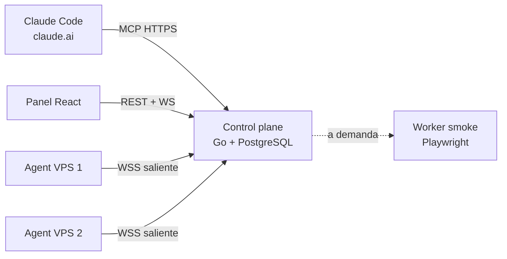
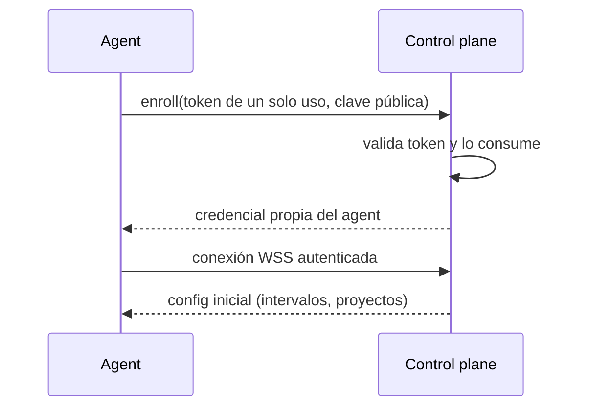
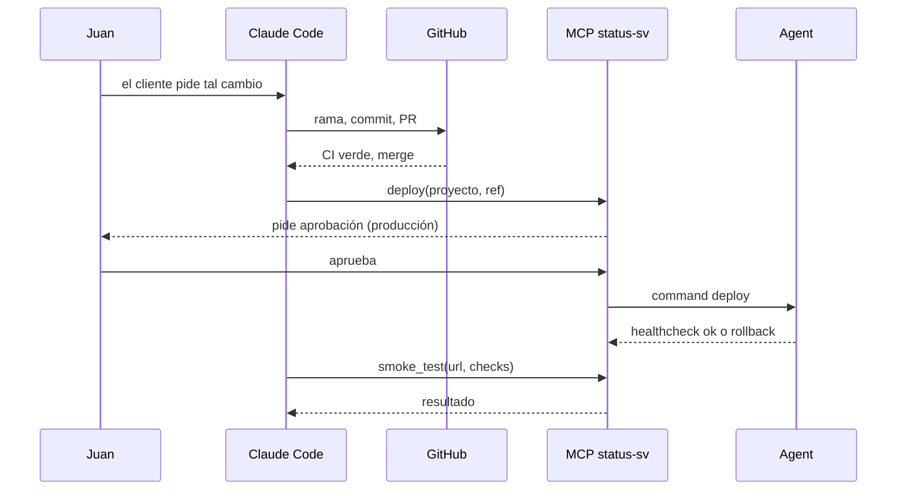

# status-sv: Documento de diseño

Última actualización: 2026-09-28

## Visión y alcance

status-sv es una plataforma propia para observar y operar servidores VPS: un panel con métricas y estado en vivo, y un MCP remoto para que Claude Code (y después claude.ai) despliegue, reconstruya y verifique proyectos sin recibir acceso de shell.

**Objetivos**

- Ver en un solo panel CPU, RAM, disco, red, contenedores y servicios de todos los servidores.
- Automatizar el ciclo repetitivo: cambio pedido → PR → merge → deploy → healthcheck → verificación web.
- Consumir muy poco: agent por debajo de 30 MB de RAM y 1% de CPU en reposo.
- Ser seguro para darle a un LLM acceso a producción: herramientas tipadas, scopes, aprobaciones y auditoría.

**Dentro del MVP (Fases 1 a 3)**

- Agent en Go con métricas, Docker y systemd.
- Control plane con API, WebSocket y PostgreSQL.
- Panel React multi-servidor.
- Motor de deploy con healthcheck y rollback.
- MCP remoto por HTTPS con tokens y scopes, conectado a Claude Code.

**Fuera del MVP**

- Multiusuario u organizaciones, facturación y roles finos.
- Agents para Windows o macOS.
- Orquestación tipo Kubernetes y autoscaling.
- Edición libre de archivos de configuración desde el panel; solo las plantillas del proxy son editables.
- OAuth para claude.ai (Fase 4).

## Principios de diseño

Seis reglas guían cada decisión: si una funcionalidad las rompe, se rediseña.

1. **El LLM llama operaciones, no comandos.** El MCP expone herramientas tipadas (`deploy`, `rollback`, `get_logs`) y nunca `run_shell`. La lógica riesgosa vive en código determinístico.
2. **El agent solo hace conexiones salientes.** Ningún VPS abre puertos nuevos ni deja SSH expuesto para que el panel lo controle.
3. **Solo se despliega lo declarado.** Un proyecto debe tener su `project.yaml`; lo demás se observa en modo solo lectura.
4. **Los secretos nunca viajan al LLM ni al panel.** Se resuelven en el servidor donde corre el agent.
5. **Toda acción deja rastro.** Quién (persona o LLM), qué, cuándo y con qué resultado, en un log de auditoría inmutable.
6. **Liviano por diseño.** Se mide desde el primer sprint contra metas concretas (ver Metas de rendimiento), no se optimiza al final.

## Arquitectura

Son cuatro piezas: un agent por servidor, un control plane que concentra todo, un MCP como capa fina encima de la API, y un panel web. Los agents se conectan hacia afuera y mantienen un canal abierto.



Los agents inician la conexión, así que el control plane nunca necesita alcanzar a los VPS. Por el mismo canal viajan las métricas hacia arriba y las órdenes hacia abajo.

| Pieza | Responsabilidad | Corre en |
| --- | --- | --- |
| Agent | Recolecta métricas de `/proc` y del stream de eventos de Docker. Ejecuta deploys, restarts y rollbacks de proyectos declarados. | Cada VPS, como servicio systemd |
| Control plane | API REST, WebSocket para el panel, MCP, auth, auditoría, aprobaciones y agregación de métricas. | Un VPS central, un binario |
| MCP | Herramientas tipadas sobre la API. No tiene lógica propia. | Dentro del control plane |
| Panel | Vistas de servidores, proyectos, deploys y auditoría. Se compila a estáticos embebidos en el binario. | Servido por el control plane |
| Worker de smoke tests | Playwright headless que se levanta a demanda para verificar URLs. | Contenedor aparte |

**Adaptadores de runtime del agent**

- **Docker:** contenedores, estado, healthchecks, logs y consumo por contenedor.
- **systemd:** servicios como gunicorn y nginx, con logs vía journald.
- **Descubrimiento de procesos:** lo que corre fuera de Docker y systemd aparece como "no gestionado", solo lectura.

## Stack tecnológico

Go en agent y servidor, PostgreSQL como base, y React con Vite para el panel. La prioridad es bajo consumo y velocidad, con un front de aspecto profesional.

| Capa | Elección | Por qué |
| --- | --- | --- |
| Agent | Go | Binario estático único, 15 a 30 MB de RAM, casi 0% de CPU en reposo, sin dependencias en el VPS. |
| Control plane y MCP | Go | Mismo lenguaje que el agent: tipos compartidos y un solo binario. Maneja miles de conexiones con poca memoria. |
| Base de datos | PostgreSQL | Concurrencia real, tipos JSONB, particionado por tiempo para métricas y migraciones maduras. |
| Acceso a datos | `pgx` + `sqlc` | Consultas SQL tipadas y generadas, sin ORM pesado. |
| Migraciones | `goose` ([ADR-004](adr/ADR-004-modulo-go-unico-y-goose.md)) | Versionadas dentro del repo, embebidas en el binario y aplicadas con un subcomando explícito. |
| Front | React + Vite + TypeScript | Se compila a estáticos y en producción no hay Node corriendo. |
| UI | Tailwind + shadcn/ui | Aspecto profesional sin diseñar todo desde cero. |
| Gráficos | uPlot | La librería de series de tiempo más liviana y rápida para métricas en vivo. |
| Estado del front | TanStack Query + WebSocket | Datos en vivo sin polling. |
| Contratos | JSON versionado en `proto/` ([ADR-003](adr/ADR-003-contratos-json-versionado.md)) | Un solo origen para los mensajes agent ↔ servidor, legible al depurar. |
| Smoke tests | Playwright | En un worker aparte, porque el navegador es pesado. |
| Despliegue propio | Docker Compose, detrás de Caddy o de un nginx existente | Caddy da HTTPS automático en un servidor dedicado; hoy corre detrás del nginx de un cliente ([ADR-007](adr/ADR-007-control-plane-en-servidor-de-cliente.md)). |

**Sobre PostgreSQL**

La base corre como un contenedor más en el VPS central. Para métricas se usan tablas particionadas por día (o TimescaleDB si el volumen lo pide). No hace falta TimescaleDB en el MVP: el particionado nativo y los agregados propios alcanzan para decenas de servidores.

**Sobre Go**

Tu stack fuerte hoy es Python, así que las primeras semanas van a ser de curva. Por eso el Sprint 0 incluye un agent mínimo de punta a punta, para aprender el lenguaje sobre algo real y acotado.

## Modelo de datos

Catorce entidades cubren el MVP. Las métricas crudas y agregadas viven particionadas por tiempo para que borrar datos viejos sea soltar una partición, no un DELETE masivo, y sus discos e interfaces van en tablas aparte ([ADR-008](adr/ADR-008-tablas-de-metricas.md)).

| Tabla | Contenido | Notas |
| --- | --- | --- |
| `servers` | Nombre, host, estado, versión del agent, último contacto, etiquetas. | Un registro por VPS enrolado. |
| `agent_credentials` | Hash de credencial por agent, fecha de emisión y revocación. | Se guarda solo el hash. |
| `enrollment_tokens` | Token de un solo uso, expiración y servidor resultante. | Vence en 15 minutos. |
| `projects` | Servidor, nombre, tipo de runtime (docker o systemd), URL de healthcheck, entorno, y el último resultado del healthcheck. | Nace del `project.yaml` que el agent lee en su servidor; el control plane no lo puede crear ni cambiar ([ADR-012](adr/ADR-012-proyectos-declarados-en-el-servidor.md)). |
| `deploys` | Proyecto, referencia (commit o tag), estado, iniciador, tiempos, logs resumidos. | Estados: pending, approved, running, succeeded, failed, rolled_back. |
| `runtime_units` | Último estado conocido de cada contenedor, servicio y proceso no gestionado de un servidor: nombre, estado, consumo y cuándo se lo vio. `runtime_sources` guarda si cada fuente (Docker, systemd, procesos) se pudo leer, y `servers.runtime_taken_at` la marca de la última foto. | Se reemplaza con cada `runtime_state`; no guarda historia. |
| `metrics_raw` | Servidor, instante, CPU (uso, iowait, steal), RAM, swap y carga. Los discos van en `metrics_raw_disks` y las interfaces en `metrics_raw_networks`, una fila por cada uno y por muestra. | Partición diaria, retención 48 horas. |
| `metrics_1m` | Lo mismo agregado por minuto: promedio y máximo de CPU, iowait, memoria y swap, el peor momento de cada disco y tasas de red. También con `metrics_1m_disks` y `metrics_1m_networks`. | Partición mensual, retención 30 días. |
| `metrics_1h` | Agregado por hora desde `metrics_1m`: mínimo y promedio de los promedios por minuto, y máximo de los máximos. También con `metrics_1h_disks` y `metrics_1h_networks`. | Partición mensual, retención 1 año. |
| `audit_log` | Actor, tipo de actor (persona o LLM), acción, objetivo, resultado, IP. | Solo inserciones. |

**Tablas de acceso**

- `users`: cuenta del panel con hash de contraseña (argon2id) y secreto TOTP cifrado; los códigos de recuperación van en `user_recovery_codes`, como hash ([ADR-013](adr/ADR-013-segundo-factor-totp.md)).
- `sessions`: sesión del panel, guardada como hash del token que viaja en la cookie; vence a las 24 h sin uso o a los 7 días ([ADR-010](adr/ADR-010-usuarios-y-sesiones-del-panel.md)).
- `api_tokens`: token del MCP con hash, scopes por proyecto y entorno, y vencimiento.
- `approvals`: solicitud de aprobación humana con el deploy asociado, quién aprobó y cuándo.

**Reglas**

- Los IDs son UUID v7, que se ordenan por tiempo y son buenos índices.
- `audit_log` no admite UPDATE ni DELETE: se aplica con permisos del rol de la aplicación.
- La ingesta recalcula el agregado por minuto de los minutos que toca cada lote, en la misma transacción y siempre desde el crudo, así que las muestras que llegan tarde o repetidas no lo desarman ([ADR-009](adr/ADR-009-agregado-por-minuto-en-la-ingesta.md)). El agregado por hora (`metrics_1h`, Sprint 3) sigue el mismo camino a partir de `metrics_1m`. Un job interno crea las particiones por adelantado y borra las vencidas, cada hora, con funciones de la migración que escapan los nombres ([ADR-008](adr/ADR-008-tablas-de-metricas.md)). Todos los cortes son en UTC y no hay partición por defecto.
- Los estados de servidor (online, offline, degradado) se derivan del último contacto, no se escriben a mano.

## Protocolo agent ↔ control plane

El agent abre un WebSocket seguro (WSS) hacia el control plane y lo mantiene abierto. Los mensajes son binarios (Protobuf) o JSON compacto, definidos en `proto/`, y llevan versión para poder actualizar agents sin romper compatibilidad.

**Enrolamiento**



El token se genera desde el panel, se usa una vez y vence a los 15 minutos. Después el agent usa su propia credencial, revocable desde el panel. La meta es mTLS en la Fase 4.

**Mensajes**

| Dirección | Mensaje | Contenido | Frecuencia |
| --- | --- | --- | --- |
| Agent → servidor | `metrics` | Lote de muestras de CPU, RAM, disco, red y carga. | Cada 5 a 10 s |
| Agent → servidor | `runtime_state` | Foto completa de contenedores, servicios y procesos no gestionados, con su estado y consumo. | Al cambiar algo, y cada tanto con el consumo al día |
| Agent → servidor | `projects_state` | Proyectos declarados en el servidor, los archivos inválidos (sin su contenido) y el resultado del healthcheck. | Al cambiar algo, y cada 5 minutos |
| Agent → servidor | `deploy_event` | Avance y resultado de un deploy. | Por evento |
| Agent → servidor | `heartbeat` | Vivo y versión. | Cada 15 s |
| Servidor → agent | `command` | Operación predefinida con parámetros validados. | A demanda |
| Servidor → agent | `config_update` | Nuevos intervalos o proyectos declarados. | A demanda |

**Comandos permitidos**

`deploy`, `rollback`, `restart`, `stop`, `start`, `get_logs`, `healthcheck`, `discover` y `bootstrap` (deploy desde cero). El agent rechaza cualquier comando fuera de esta lista y cualquier proyecto que no esté declarado.

**Confiabilidad**

- Cada comando lleva un ID y el agent responde con un acuse; los comandos son idempotentes.
- Si se corta la conexión, el agent reconecta con backoff exponencial y acumula métricas en un buffer en memoria de hasta 10 minutos.
- Las métricas viajan con un solo lote en vuelo: el siguiente sale cuando llega el acuse, que confirma hasta qué marca de tiempo se guardó. Si el acuse no llega en 30 s o se corta el canal, el lote se reenvía, así que el control plane guarda de forma idempotente. Ningún mensaje del agent pasa de 256 KiB: los lotes grandes salen partidos.
- Un deploy en curso sigue aunque se corte el canal; el agent reporta el resultado al reconectar.
- Un servidor sin heartbeat por más de 45 s pasa a offline.

## MCP: herramientas, auth y aprobaciones

El MCP es remoto, usa transporte Streamable HTTP y vive dentro del control plane. Cada herramienta es una operación acotada con parámetros validados; ninguna acepta comandos libres.

| Herramienta | Tipo | Qué hace | Aprobación en producción |
| --- | --- | --- | --- |
| `list_servers` | Lectura | Servidores con estado y último contacto. | No |
| `get_server_metrics` | Lectura | CPU, RAM, disco y red en un rango de tiempo. | No |
| `list_projects` | Lectura | Proyectos por servidor, runtime y entorno. | No |
| `get_project_status` | Lectura | Estado, versión desplegada y healthcheck. | No |
| `get_logs` | Lectura | Últimas N líneas, con secretos enmascarados. | No |
| `list_deploys` | Lectura | Historial de deploys de un proyecto. | No |
| `deploy` | Escritura | Despliega una referencia con healthcheck y rollback automático. | Sí |
| `rollback` | Escritura | Vuelve a la versión anterior conocida. | Sí |
| `restart` | Escritura | Reinicia un proyecto declarado. | Sí |
| `smoke_test` | Verificación | Abre la URL con Playwright y valida checks definidos. | No |

**Autenticación**

1. **Etapa 1:** tokens de API con scopes por proyecto y entorno (por ejemplo `deploy:staging` sin `deploy:production`), con vencimiento y revocación. Alcanza para Claude Code.
2. **Etapa 2:** OAuth 2.1 con registro dinámico de clientes, que es lo que necesita claude.ai para conectores remotos.

**Aprobaciones**

Las herramientas de escritura sobre entornos de producción devuelven `pending_approval` con un ID. Vos aprobás o rechazás desde el panel (o con un enlace firmado), y recién ahí el control plane envía el comando al agent. Los entornos de staging pueden configurarse sin aprobación.

**Flujo completo con Claude Code**



Claude Code hace el trabajo de git y PR con `git` y `gh` locales. El MCP se ocupa de lo que Claude Code no puede hacer solo: desplegar, ver el estado real del servidor y verificar la web.

## Deploy desde cero

Además de actualizar proyectos existentes, status-sv levanta un proyecto completo en un servidor a partir de su repositorio. Es una operación distinta del `deploy` común porque crea cosas nuevas (directorio, servicio, proxy, certificado), así que siempre pide aprobación humana, también en staging.

| Herramienta | Qué hace |
| --- | --- |
| `register_project` | Declara el proyecto nuevo: repo, servidor, runtime, entorno, dominio, healthcheck y variables requeridas. |
| `bootstrap_project` | Ejecuta el primer deploy completo de un proyecto ya declarado. |

**Pasos del bootstrap**

1. **Clonar:** el agent crea el directorio de trabajo y clona el repo con una deploy key de solo lectura, una por proyecto.
2. **Secretos:** el agent revisa las variables que el proyecto declara como requeridas. Los valores los cargás vos en el panel; el LLM nunca los ve. Si falta alguna, el bootstrap queda bloqueado y lo informa.
3. **Build y arranque:** con Docker, `compose build` y `up -d`. Con gunicorn, crea el entorno virtual, instala dependencias y genera la unidad systemd desde una plantilla.
4. **Entrada web:** genera el bloque de nginx o Caddy desde una plantilla con dominio y puerto validados, prueba la configuración, recarga y pide el certificado. La plantilla se edita desde el panel, con vista previa y validación antes de aplicar.
5. **Pasos declarados:** migraciones o carga inicial, solo si están listadas en el `project.yaml` aprobado.
6. **Verificación:** healthcheck y `smoke_test`. Si algo falla, el agent deshace lo que creó (detiene el servicio, quita el bloque de proxy) y deja el error en el historial.

**Límites de seguridad**

- Las plantillas de systemd y del proxy reciben parámetros validados, nunca texto libre del LLM. Las plantillas solo las edita una persona desde el panel, y cada cambio queda auditado.
- Los comandos previos y posteriores son solo los que declaraste al registrar el proyecto y aprobaste.
- La deploy key de cada proyecto se guarda cifrada en el servidor y se puede revocar desde el panel.

## Seguridad

El riesgo central es que un LLM con acceso a producción puede ser engañado. El diseño asume que el LLM puede equivocarse o ser manipulado, y limita el daño posible en cada capa.

| Amenaza | Mitigación |
| --- | --- |
| Prompt injection (un issue, PR o web con texto malicioso que induce a desplegar o borrar) | Herramientas acotadas, sin `run_shell`, aprobación humana en producción y auditoría de cada acción. |
| Token del MCP filtrado | Scopes por proyecto y entorno, vencimiento corto, revocación inmediata y alerta ante uso desde una IP nueva. |
| Agent comprometido o falso | Enrolamiento con token de un solo uso, credencial propia revocable y mTLS en la Fase 4. |
| Control plane comprometido | El agent solo ejecuta comandos de la lista permitida sobre proyectos declarados; no hay ejecución arbitraria. |
| Acceso al socket de Docker (equivale a root) | El agent corre con usuario dedicado, sin exponer el socket por red y con operaciones predefinidas únicamente. |
| Fuga de secretos | Las variables de entorno se resuelven en el servidor; los logs pasan por un filtro que enmascara patrones de secretos. |
| Deploy de código no revisado | El deploy exige una referencia que haya pasado por PR con CI verde y branch protection. |
| Abuso o error repetido | Límites de frecuencia por token y por proyecto, con bloqueo de deploys simultáneos sobre el mismo proyecto. |

**Controles transversales**

- HTTPS obligatorio en todo, con Caddy y certificados automáticos.
- Contraseñas con argon2id y TOTP obligatorio para cuentas con permiso de aprobar.
- Auditoría inmutable con actor, tipo de actor (persona o LLM), acción, objetivo y resultado.
- Actualizaciones firmadas del agent (verificación de checksum y firma antes de reemplazar el binario).
- El control plane corre sin privilegios de root, en contenedor, con el sistema de archivos en solo lectura donde sea posible.

**Chequeos de seguridad del servidor (Fase 4)**

Intentos fallidos de SSH, puertos abiertos, actualizaciones pendientes, expiración de certificados, estado de backups y contenedores corriendo como root.

## Metas de rendimiento

Las metas se verifican desde el Sprint 1 con pruebas automáticas; si una se rompe, el pipeline falla.

| Métrica | Meta | Cómo se mide |
| --- | --- | --- |
| RAM del agent en reposo | Menos de 30 MB | El agent mide su propia memoria y la manda en el latido; la prueba de carga la verifica. |
| CPU del agent en reposo | Menos de 1% | Promedio de los latidos: 2 minutos en cada PR y 10 en el workflow nocturno. |
| RAM del control plane con 10 agents | Menos de 100 MB | Prueba de carga con agents simulados, que usan el cliente del agent de verdad. |
| Latencia métrica → pantalla | Menos de 2 s | Marca de tiempo en el agent contra render en el front. |
| Carga inicial del panel | Menos de 1 s en conexión normal | Lighthouse en CI. |
| Tamaño del bundle del front | Menos de 300 KB comprimido | Análisis del build de Vite. |
| Tamaño del binario del agent | Menos de 15 MB | Verificación en el build. |
| Inicio de un deploy | Menos de 3 s desde la orden | Evento `deploy_event` de arranque. |

**Cómo se logra**

- El agent lee `/proc` directamente y escucha el stream de eventos de Docker en vez de consultar cada tanto.
- Las métricas se envían en lotes y solo se manda lo que cambió.
- El front se suscribe únicamente a lo que está mirando y las listas largas van virtualizadas.
- Retención escalonada: crudo 48 horas, un minuto 30 días, una hora 1 año.

## Estructura del repo

Un monorepo con un módulo Go compartido, el front y los contratos. Un solo repositorio simplifica los cambios que cruzan agent, servidor y panel.

```text
status-sv/
├── agent/            # Go: binario que corre en cada VPS
│   ├── cmd/agent/    # y cmd/loadtest: agents simulados para la prueba de carga
│   └── internal/     # collector, config, state, selfstat, ws; después docker, systemd, deploy
├── server/           # Go: API + MCP + WebSocket + embed del front
│   ├── cmd/server/
│   ├── internal/     # api, auth, config, enrollment, metrics, panel, store; después mcp, approvals
│   └── migrations/   # SQL versionado
├── internal/         # Go: código compartido por agent y server (buildinfo)
├── web/              # React + Vite + TypeScript
├── proto/            # contratos agent ↔ server
├── worker-smoke/     # Playwright, a demanda
├── deploy/           # compose y Caddyfile del control plane
├── docs/             # este documento y decisiones (ADR)
└── .github/workflows # CI: lint, tests, build, metas de rendimiento
```

**Convenciones**

- Ramas cortas desde `main`, PR obligatorio y CI verde para mergear.
- Commits con el formato Conventional Commits, para generar changelog y versiones.
- Versionado semántico; el agent y el servidor negocian versión de protocolo al conectar.
- Cada decisión de arquitectura importante se registra como ADR corto en `docs/adr/`.
- Tests: unitarios en Go y Vitest en el front, más una prueba de integración con Docker que levanta servidor, base y un agent.
- Formato y lint automáticos: `gofmt` y `golangci-lint` en Go; ESLint y Prettier en el front.

**Formato del `project.yaml`**

Cada proyecto es un archivo en `/etc/status-sv/projects.d/<nombre>.yaml`, en el mismo servidor
donde corre. Lo escribe una persona por SSH y el agent solo lo lee
([ADR-012](adr/ADR-012-proyectos-declarados-en-el-servidor.md)).

```yaml
name: cristales-baez       # igual al nombre del archivo
environment: production    # production | staging
repo: github.com/extendsystem/cristales-baez
branch: main
runtime: docker            # docker | systemd
compose_file: docker-compose.yml
compose_project: cristales-baez   # opcional; si falta, el nombre del directorio de workdir
workdir: /srv/cristales-baez
healthcheck:
  url: https://cristales.example.com/health
  expect_status: 200
  timeout_seconds: 10      # de 1 a 30
deploy:
  pre: []                  # vacío hasta que el Sprint 4 defina los pasos declarados
  post: []
rollback: previous_image
```

Un proyecto de systemd lleva `runtime: systemd` y, en vez de `compose_file` y `compose_project`,
la lista de sus servicios en `units` (por ejemplo `[gunicorn-cristales.service]`). El campo `server`
ya no existe: el servidor es el que tiene el archivo.

El ejemplo usa datos ilustrativos; los valores reales los definís vos por proyecto.

## Fases y roadmap

El MVP útil llega al final de la Fase 3, con unas 15 semanas de trabajo. Las estimaciones son aproximadas y suponen sprints de 2 semanas con un solo desarrollador a medio tiempo, aprendiendo Go sobre la marcha; conviene revisarlas al cierre del Sprint 1.

| Fase | Objetivo | Sprints | Criterio de salida |
| --- | --- | --- | --- |
| Sprint 0 | Fundaciones: repo, CI, PostgreSQL, un agent mínimo que se conecta y envía un latido. | 1 semana | Un agent real aparece como online en la base. |
| Fase 1 | Observabilidad: métricas y estado de Docker y systemd de varios servidores en el panel. | Sprints 1 a 3 | Dos VPS visibles en vivo, con las metas de rendimiento cumplidas. |
| Fase 2 | Motor de deploy con healthcheck, rollback y auditoría, disparable desde el panel. | Sprints 4 y 5 | Un proyecto Docker y uno gunicorn se despliegan y hacen rollback solos. |
| Fase 3 | MCP remoto con tokens, scopes y aprobaciones, conectado a Claude Code. | Sprints 6 y 7 | El flujo completo (PR, merge, deploy aprobado, verificación) corre desde Claude Code. |
| Fase 4 | Smoke tests, alertas, chequeos de seguridad, mTLS y OAuth para claude.ai. | Sprints 8 en adelante | claude.ai usa el MCP con OAuth y hay alertas activas. |

**Qué entra en cada fase**

- **Fase 1:** enrolamiento de agents, métricas, estado de contenedores y servicios, procesos no gestionados, vista de servidores y de proyectos, login del panel, gráficos en vivo.
- **Fase 2:** lectura de `project.yaml`, deploy Docker Compose y systemd, healthcheck, rollback, historial, logs en el panel, bloqueo de deploys simultáneos.
- **Fase 3:** herramientas MCP de lectura y escritura, tokens con scopes, aprobaciones en el panel, límites de frecuencia, auditoría con actor LLM.
- **Fase 4:** worker Playwright, alertas (correo o Telegram), chequeos de seguridad del servidor, actualización del agent desde el panel, OAuth 2.1.

El deploy desde cero (`bootstrap_project`) se construye al cierre de la Fase 2, en el Sprint 5, sobre el deploy Docker y el de systemd, y se expone por MCP en el Sprint 7. Si el Sprint 4 muestra que el alcance no entra, se mueve al Sprint 6.

**Ideas para más adelante**

Gestión de backups, renovación y estado de certificados, comparación entre entornos, plantillas de proyecto, notificaciones de deploy a clientes, y un modo staging automático por cada PR.

## Sprints 0 a 3

El Sprint 0 deja la base funcionando de punta a punta con lo mínimo, el Sprint 1 entrega la primera vista útil (las métricas de un servidor en vivo), el Sprint 2 suma lo que corre adentro (contenedores, servicios y procesos) y el Sprint 3 cierra la Fase 1 con los proyectos y un segundo servidor.

**Sprint 0 (1 semana): fundaciones**

Objetivo: un agent real conectado al servidor y visible en la base de datos.

- [x] Crear el monorepo con la estructura definida, README y `.gitignore`.
- [x] Configurar GitHub Actions con lint, tests y build de Go. El del front entra en el Sprint 1, con el front.
- [x] Armar el Docker Compose de desarrollo con PostgreSQL y el servidor. El de desarrollo lleva PostgreSQL y el servidor se corre con `go run`; el de la prueba de punta a punta levanta todo junto.
- [x] Escribir la primera migración: `servers`, `enrollment_tokens` y `agent_credentials`.
- [x] Levantar un servidor Go mínimo con `/healthz` y el endpoint WSS para agents.
- [x] Definir en `proto/` los mensajes `enroll`, `heartbeat` y `metrics`.
- [x] Programar un agent Go mínimo: enrolamiento con token y latido cada 15 s.
- [x] Escribir ADR-001 (Go y PostgreSQL) y ADR-002 (agent con conexión saliente).

Terminado cuando el agent corre como servicio systemd en un VPS real y `servers.last_seen` se actualiza solo.

**Cumplido el 2026-09-21**, en `cristales-baez-prod` y con el control plane en
`status.extendsystem.com` ([ADR-007](adr/ADR-007-control-plane-en-servidor-de-cliente.md)): el
latido actualiza `last_seen` cada 15 s y sobrevive a un reinicio del control plane. El agent midió
**12,3 MB de RAM** y **cero ticks de CPU en 60 s** en reposo, con un binario de 7,2 MB. Las metas de
memoria y tamaño se cumplen; la de CPU apunta a cumplirse, pero su medición formal (promedio de 10
minutos en CI) es del Sprint 1. Se entregó en diez PR, más ADR-003 a ADR-007.

**Sprint 1 (2 semanas): métricas de un servidor**

Objetivo: ver CPU, RAM, disco y red de un servidor en el panel, en vivo.

Agent

- [x] Colector de CPU, RAM, disco, red y carga leyendo `/proc`.
- [x] Envío en lotes cada 10 s con buffer en memoria y reconexión con backoff.
- [x] Medición de la RAM y CPU propias del agent, expuestas en su latido. Ya venía del Sprint 0; la medición formal de 10 minutos en CI es parte de la prueba de carga.

Servidor

- [x] Migración de `metrics_raw` (partición diaria) y `metrics_1m`, con discos e interfaces en tablas aparte.
- [x] Recepción de lotes y escritura por `COPY` o inserción masiva. Es inserción masiva con `unnest` y `ON CONFLICT DO NOTHING`, idempotente ante reenvíos, en una transacción por lote.
- [x] Agregación de crudo a un minuto y borrado de particiones vencidas. La agregación no es un job: la hace la ingesta en la transacción de cada lote ([ADR-009](adr/ADR-009-agregado-por-minuto-en-la-ingesta.md)).
- [x] Usuarios y sesiones del panel: argon2id, sesión en la base con cookie `HttpOnly`, `Secure` y `SameSite=Strict`, límite de intentos, y alta del primer usuario por SSH ([ADR-010](adr/ADR-010-usuarios-y-sesiones-del-panel.md)).
- [x] API `GET /v1/servers` (con estado y última muestra) y `GET /v1/servers/{id}/metrics?from&to&resolution`, detrás de la sesión del panel.
- [x] WebSocket del panel (`GET /v1/panel/connect`) con suscripción por servidor: las muestras llegan en vivo apenas se guardan.

Panel

- [x] Scaffold con React, Vite, TypeScript y Tailwind, con componentes propios al estilo de shadcn/ui, router `wouter`, TanStack Query y CI del front con tope de 300 KB comprimido.
- [x] Login con sesión por cookie segura.
- [x] Lista de servidores con estado, uso de CPU, memoria y el disco más lleno.
- [x] Vista de un servidor con gráficos uPlot en vivo y rango de tiempo. El rango en crudo (1 hora) avanza con las muestras del canal en vivo; los más largos se dibujan con el agregado por minuto y su pico.

Calidad

- [x] Prueba de carga con 10 agents simulados y verificación automática de las metas de RAM y CPU (deploy/carga/run.sh): 2 minutos en cada PR y 10 en el workflow nocturno, con la decisión de Juan sobre la medición de CPU.
- [x] Embebido del front compilado en el binario del servidor, con `go:embed`: la raíz sirve el panel, las rutas del front devuelven el mismo index y los archivos con hash se cachean para siempre.

Terminado cuando un VPS real muestra sus métricas en vivo en el panel, con el agent por debajo de 30 MB de RAM y 1% de CPU, y el CI verde.

**Cerrado el 2026-09-23** (commit `df06653`, desplegado en `cristales-baez-prod`): el panel muestra
CPU, memoria, los tres discos reales y `eth0` del servidor, con los gráficos avanzando solos por el
WebSocket. Medido ahí mismo: agent 6,5 MB de RAM y 0,1 s de CPU acumulados; control plane 5,5 MB.
La prueba de carga con diez agents simulados da 20 MB para el control plane. Queda pendiente
Cloudflare Access delante del panel (lo configura Juan) y la meta de Lighthouse, que solo tiene
sentido medir contra el despliegue con compresión.

**Sprint 2 (2 semanas): Docker, systemd y procesos**

Objetivo: ver los contenedores, los servicios y los procesos no gestionados de un servidor, en
vivo, y poder pedir sus logs desde el panel. Las seis decisiones que lo abrían las tomó Juan el
2026-09-24 y están en [ADR-011](adr/ADR-011-acceso-a-docker-y-journald.md).

Agent

- [x] Acceso a Docker por el grupo `docker`, en un drop-in que escribe el instalador, y al diario
      por el grupo `systemd-journal`; endurecimiento de la unidad revisado en el laboratorio local.
- [x] Cliente propio mínimo del socket de Docker: lista de contenedores, estado, healthcheck y el
      stream de eventos (sin los `exec_*` de los healthchecks), que reabre solo si se corta.
- [x] Servicios de systemd por D-Bus de solo lectura: lo que corre, lo que falló y lo habilitado que
      está parado, sin los oneshot que ya terminaron ni una lista de exclusión (`systemd-*`, `user@*`, `dbus`).
      De lo parado o caído viaja cómo terminó (`result` de systemd): lo que terminó bien se muestra en
      gris, sin contar como alarma, y lo que no arrancó porque su condición no se cumple en ese servidor
      no se muestra. Salió del despliegue: en producción, tres servicios que habían terminado bien
      aparecían "para revisar".
- [x] Procesos no gestionados: recorrido de `/proc` con atribución por cgroup (Docker, servicio o
      ninguno), los 20 más pesados por memoria y CPU, solo lectura.
- [x] Consumo de cada unidad desde cgroup v2 (`cpu.stat`, `memory.current` sin la caché inactiva, como
      `docker stats`), sin preguntarle a ningún demonio.
- [x] Una sola foto de runtime armada con los tres adaptadores y el consumo de cgroups. Se mira cada
      30 s y después de cada cambio (con 1 s de respiro), pero sale solo si cambió algo (el consumo,
      redondeado) o pasaron 5 minutos; una en vuelo, acuse y reenvío como las métricas.

Servidor

- [x] Mensajes `runtime_state` y `runtime_state_ack` en `proto/`, con topes por tipo (200
      contenedores, 300 servicios, 20 procesos) y archivos golden.
- [x] Tablas `runtime_units` y `runtime_sources`: cada foto reemplaza lo de cada fuente según su estado
      (con `error` se conserva lo anterior), en una transacción, y una foto más vieja que la guardada
      se confirma sin aplicarse. Este PR se adelantó al envío del agent: el receptor antes que el emisor.
- [x] `GET /v1/servers/{id}/runtime` detrás de la sesión, y el estado nuevo empujado por el
      WebSocket del panel a quien esté suscripto.

Panel

- [x] Secciones de contenedores, servicios y procesos en la vista de un servidor, en vivo, con lo que
      tiene problemas primero y los contenedores detenidos escondidos hasta que se piden. Sin
      virtualizar: con los topes del contrato (200 y 300) una lista común alcanza y no suma dependencias.
- [x] Pedido de logs por unidad desde el panel, con los últimos 200 renglones (`POST /v1/servers/{id}/logs`).

Logs a demanda

- [x] Canal de comandos mínimo (`command` / `command_ack`) con ID, acuse e idempotencia, y una sola
      operación permitida: `get_logs`, solo sobre lo que el agent vio en su última foto. Una respuesta
      solo vale si llega por el canal del agent al que se le mandó el comando.
- [x] Filtro de enmascarado de secretos **en el agent**: lo que sale del VPS ya está enmascarado. Se
      adelantó al PR de procesos, porque la línea de comando de un proceso ya puede traer una contraseña.

Terminado cuando un VPS real muestra sus contenedores, servicios y procesos en vivo en el panel, se
pueden pedir los logs de una unidad con los secretos enmascarados, el agent sigue por debajo de
30 MB de RAM y 1% de CPU con Docker prendido, y el CI está verde.

**Cerrado el 2026-09-28** (commit `307038a`, desplegado en `cristales-baez-prod`): el agent ve los 11
contenedores, 17 servicios y los procesos sueltos del servidor, con las tres fuentes en `ok` y el
consumo por contenedor igual al de `docker stats`. Medido ahí con Docker prendido: agent 8,6 MB de
RAM y 0,11 % de un núcleo; control plane 5,3 MB. El cotizador del cliente respondió 200 antes,
durante y después, y nginx no se tocó.

Si el sprint se estira, la línea de corte son los logs a demanda (el canal de comandos y su vista),
que se mueven al Sprint 3 sin romper nada de lo anterior.

**Sprint 3 (2 semanas): proyectos y cierre de la Fase 1**

Objetivo: ver cada proyecto declarado con sus contenedores o servicios y su healthcheck, en dos
servidores reales, con historia de un año y el panel protegido con TOTP. Las decisiones que lo
abrían las tomó Juan el 2026-09-28: [ADR-012](adr/ADR-012-proyectos-declarados-en-el-servidor.md)
(dónde viven los proyectos, cómo se ligan y el healthcheck), [ADR-013](adr/ADR-013-segundo-factor-totp.md)
(TOTP) y mover el control plane a un VPS propio en este sprint, como pide
[ADR-007](adr/ADR-007-control-plane-en-servidor-de-cliente.md) antes del segundo servidor y de la
escritura del Sprint 4.

Métricas

- [x] Tablas `metrics_1h`, `metrics_1h_disks` y `metrics_1h_networks`, con partición mensual y un año
      de retención. La ingesta recalcula la hora que toca cada lote a partir de `metrics_1m`, en la
      misma transacción, como el minuto ([ADR-009](adr/ADR-009-agregado-por-minuto-en-la-ingesta.md)).
      La migración carga la hora de lo que ya hay por minuto.
- [x] La API sirve la resolución `1h` y el panel suma los rangos de 30 días, 90 días y 1 año. La
      resolución sale sola del largo del rango: hasta 3 h en crudo, hasta 48 h por minuto y más por
      hora, con una línea de mínimo además del pico.

Acceso

- [x] TOTP en el servidor: login en dos pasos, alta con confirmación, códigos de recuperación,
      secreto cifrado con la clave en un archivo, y `server user-totp-reset` por SSH.
- [x] Pantallas del panel para el código, el alta con QR y los códigos de recuperación.

Proyectos

- [x] Mensajes `projects_state` y `projects_state_ack` en `proto/`, con topes y archivos golden.
- [ ] Parser estricto de `project.yaml` en el agent (`agent/internal/projectspec`).
- [ ] El agent lee `/etc/status-sv/projects.d`, revisa cada 30 s si cambió y manda solo si cambió.
- [ ] Tabla `projects` y persistencia por servidor en una transacción; el ligado con `runtime_units`
      se calcula al leer.
- [x] `GET /v1/projects` y `GET /v1/projects/{id}` con el estado derivado (bien, degradado o caído),
      y el cambio empujado por el WebSocket del panel.
- [ ] Vista de proyectos en el panel (lista y detalle), con enlaces desde la vista de un servidor.
- [ ] Healthcheck pasivo desde el agent cada 60 s. **Línea de corte**: si el sprint se estira, pasa
      al Sprint 4.

Calidad y despliegue

- [ ] Lighthouse y latencia métrica → pantalla medidas en CI: son las dos metas de la Fase 1 que
      faltaba verificar.
- [ ] Control plane en un VPS propio con Caddy, los dos agents apuntando ahí, y un ADR que reemplaza
      a ADR-007. Incluye desplegar #41 (migración 00005).

Terminado cuando dos VPS reales se ven en vivo en el panel, cada uno con al menos un proyecto ligado
a sus contenedores o servicios; los rangos de 30 días y un año se dibujan desde `metrics_1h`; el
login exige TOTP; se cumplen todas las metas de la Fase 1, y el CI está verde.

**Sprints siguientes (resumen)**

| Sprint | Foco | Entregable |
| --- | --- | --- |
| 3 | Proyectos y cierre de la Fase 1 | Lectura de `project.yaml`, vista de proyectos, agregado por hora, TOTP y segundo servidor en vivo. |
| 4 | Deploy Docker | `deploy` con pull, build, healthcheck y rollback automático. |
| 5 | Deploy systemd y auditoría | Deploy de gunicorn, historial de deploys y `audit_log`. |
| 6 | MCP de lectura y tokens | Herramientas de lectura, tokens con scopes, conexión con Claude Code. |
| 7 | MCP de escritura y aprobaciones | `deploy`, `rollback` y `restart` con aprobación humana en el panel. |

## Riesgos y decisiones abiertas

El mayor riesgo es de alcance: la idea es grande y el MVP tiene que seguir siendo chico. Los demás se controlan con las mitigaciones de la tabla.

| Riesgo | Impacto | Mitigación |
| --- | --- | --- |
| Alcance que crece antes de tener el MVP | Alto | Las Fases 1 a 3 son el límite; las ideas nuevas van a la lista de "más adelante". |
| Curva de aprendizaje de Go | Medio | El Sprint 0 arma algo real y acotado; el agent es chico y sirve para aprender. |
| El control plane es un punto único de falla | Medio | Los proyectos siguen corriendo si cae; se agregan backups de PostgreSQL y un restore probado. |
| Un deploy automático rompe producción | Alto | Healthcheck, rollback automático, aprobación humana y bloqueo de deploys simultáneos. |
| Proyectos gunicorn fuera de systemd | Medio | Pasarlos a systemd durante la Fase 2; hasta entonces quedan en solo lectura. |
| Prompt injection sobre el LLM | Alto | Herramientas acotadas, aprobaciones y auditoría (ver Seguridad). |
| El volumen de métricas crece más de lo previsto | Bajo | Particionado y retención escalonada; TimescaleDB si hiciera falta. |

**Decisiones cerradas** (2026-09-20, al abrir el Sprint 0)

- [x] **Uso interno, single-tenant.** Sin organizaciones ni roles finos. Ver [ADR-005](adr/ADR-005-alcance-single-tenant.md).
- [x] **Particionado nativo de PostgreSQL**, sin TimescaleDB, con criterio explícito para revisarlo. Ver [ADR-001](adr/ADR-001-go-y-postgresql.md).
- [x] **Contratos en JSON versionado**, no Protobuf; el envelope queda preparado por si hay que migrar el mensaje de métricas. Ver [ADR-003](adr/ADR-003-contratos-json-versionado.md).
- [x] **Monorepo con un único módulo Go** (`github.com/JuanBaez77/status-sv`). Ver [ADR-004](adr/ADR-004-modulo-go-unico-y-goose.md).

**Decisiones abiertas**

- [ ] ¿Alertas por correo, Telegram o ambos? Se decide en la Fase 4, al construirlas.
- [ ] ¿Las aprobaciones de producción se hacen solo desde el panel o también por un enlace firmado en el celular? Se decide en el Sprint 7.
- [ ] ¿Se mantiene la aprobación humana también en staging, o solo en producción? Se decide en el Sprint 7.
